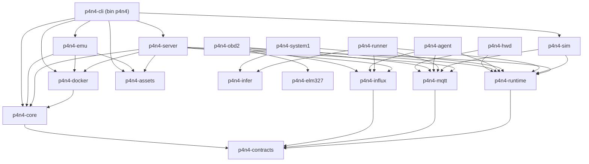
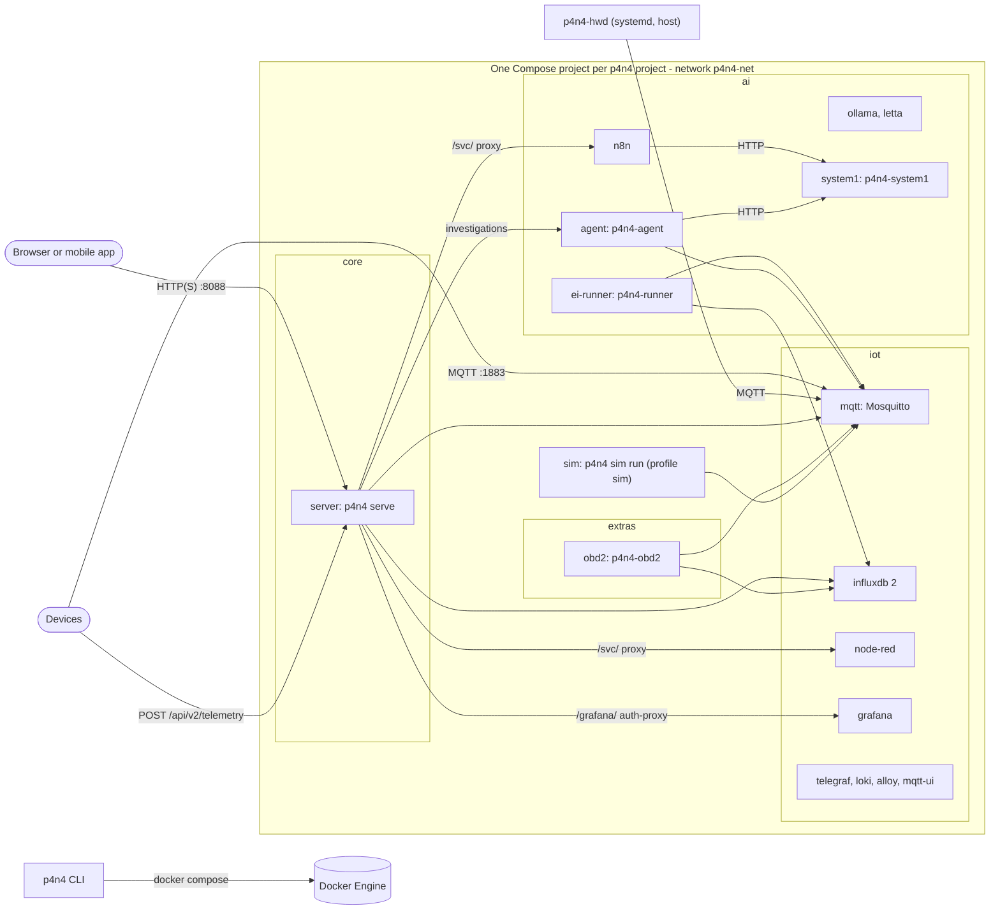

# p4n4 Rust Rewrite: Design Plan

| | |
|---|---|
| Date | 2026-10-31 |
| Status | Design proposal. Nothing is implemented yet. |
| Baseline | `raisga/p4n4@8c9957f`, which is release set v0.4.2. Submodule pins are in [Appendix D](#appendix-d-sources). |
| Replaces | The previous version of this file: a compatibility-first, staged migration that put Rust inside each component repo. It is examined in [§2](#2-examination-of-the-previous-plan). |
| Compatibility | Clean break. v0.4 projects, data, API clients and Python imports are not migrated. |

**How to read this document**

| Sections | Content |
|---|---|
| §0 to §2 | What was decided, and why the previous plan changed |
| §3 to §7 | The design |
| §8 to §11 | How the work gets built, tested and phased, and what can go wrong |
| §12 to §15 | User impact, open questions, and the documentation and ADR changes |
| Appendices | Command and route mappings, crates, and sources |

---

## 0. Summary

**What becomes Rust**

Everything p4n4 *runs*:

- the CLI and the library;
- the API server;
- the emulator and simulator;
- every first-party in-stack service: the Edge Impulse runner, System 1 inference, the investigator agent (TypeScript today), the OBD-II bridge, and the Raspberry Pi hardware daemon.

This replaces about 22.5k lines of Python and 1.2k lines of TypeScript.

**What stays as it is**

| Component | Language | Change |
|---|---|---|
| Dashboard | Flutter/Dart, about 40k lines | Adapted to API v2 |
| System 1 training | Python | Gains an ONNX export step |
| Emulator hardware shims | stdlib-only Python | Embedded in the binary |
| Letta tools | Python | None |
| Template example code | Various | None |
| Upstream service configuration: Mosquitto, Node-RED flows, n8n workflows, Grafana, Telegraf, Loki, Alloy | Various | None |

**The overall shape**

- **Repository.** One Cargo workspace in `raisga/p4n4`.
  - lib, cli, api and emu are archived.
  - stacks, templates and hardware files move in as plain directories, and their old repositories are archived at 1.0.
  - dashboard, docs and web/* stay submodules.
- **Binary and image.** A single `p4n4` binary is the CLI. Its `serve` and `emu` features add the server and the emulator.
  - The same binary ships as the image `ghcr.io/raisga/p4n4`, which serves the dashboard and `/api/v2` on port 8088.
  - nginx, Caddy, the separate API container and the dashboard layer all go away.
- **Compose.** Each p4n4 project is one Compose project.
  - A generated root `compose.yaml` pulls in each layer with `include:`.
  - There is one `.env`, and p4n4 manages `COMPOSE_PROFILES` in it.
- **Config.** `p4n4.toml` replaces `.p4n4.json`. Everything p4n4 owns is TOML; YAML is used only for third-party formats.

**Python**

- Feature freeze at v0.4.2 (critical fixes only), then archive at 1.0.
- The PyPI package `p4n4` 1.0 becomes a binary wheel of the Rust CLI.

**Platforms**

- Linux x86_64, aarch64 and armv7; Windows x86_64; macOS aarch64.
- armv7 hosts act as edge nodes: InfluxDB 2, Ollama, n8n and Letta publish no armv7 images.

**Execution order**

```text
P0 spikes S1-S9
  -> P1 assets + core
       -> P2 CLI  ||  P5 runner/obd2/hwd  ||  P6 System 1/agent
            -> P3 server + dashboard  ||  P4 emu/sim        (after P2)
                 -> P7 feature completion -> P8 hardening + 1.0
```

There is no calendar estimate until P0 ends.

---

## 1. Decisions

### 1.1 Decided by the maintainer (binding)

| # | Topic | Decision | Effect |
|---|---|---|---|
| D1 | Repository | **Monorepo.** One Cargo workspace in `raisga/p4n4`.<br>• stacks/iot, stacks/ai, stacks/extras, tools/templates and tools/hw move in as plain directories. History can optionally be kept with `git subtree add` (Q7).<br>• p4n4-lib, p4n4-cli, p4n4-api and p4n4-emu are archived. The moved repositories take only v0.4.x fixes, then are archived at 1.0.<br>• dashboard, docs and web/* stay submodules. | Supersedes ADR-001 |
| D2 | Compose topology | **One Compose project per p4n4 project.**<br>• A root `compose.yaml` uses `include:` with `env_file: .env`, and there is one root `.env`.<br>• p4n4 writes `COMPOSE_PROFILES` from the manifest.<br>• Compose v1 and the external `p4n4-net` are dropped.<br>• Containers keep the fixed name `p4n4-<svc>` (488 references in 123 files), so only one project runs per Docker host. | Amends ADR-002 |
| D3 | Dashboard | **Flutter stays.** The Rust server serves it, and the nginx image is dropped.<br>• Dart models are generated from OpenAPI.<br>• The transport stays hand-written: auth refresh, SSE and MJPEG.<br>• The service catalog, health and incidents move to the server. | Supersedes ADR-003 |
| D4 | Runtime services | Rewrite all of them in Rust: runner, sim, hwd, agent (TS), obd2, and System 1 inference. | Amends ADR-004 |
| D5 | What stays non-Rust | System 1 training (Python, plus ONNX export), emulator hardware shims (Python, embedded), Letta tools (Python), template example code, and upstream configuration. | — |
| D6 | Platforms | linux-x86_64, linux-aarch64, linux-armv7, windows-x86_64, macos-aarch64 | armv7 is an edge node and uses `tract` instead of `ort` |
| D7 | Python | Freeze at v0.4.2 (critical fixes only), archive at 1.0. | New ADR-009 |
| D8 | Existing deployments | Clean break with no migration. Volumes get project-scoped names. | [§12](#12-breaking-changes-draft-for-the-10-release-notes) |
| D9 | This file | Replace the previous plan. | [§2](#2-examination-of-the-previous-plan) |

### 1.2 Proposed defaults (accepted; revisit only with a reason)

| # | Topic | Default |
|---|---|---|
| A1 | Packaging | One binary, `p4n4`, with the cargo features `serve` (server) and `emu`. The emulator starts with `p4n4 up --emu <profile>`. |
| A2 | Docker access | The `docker compose` CLI sits behind a `ComposeDriver` trait. p4n4 parses only machine-readable output. The Engine API is used where noted in [§6.1](#61-docker-driver-p4n4-docker). |
| A3 | Operations inside the stack | `docker compose exec` / `run`, plus client subcommands built into each service binary (for example, `p4n4-system1 decide`). |
| A4 | API v2 auth | **Tokens.** Opaque, not JWT, so there is no signing secret.<br>• Access token `p4a_…`, valid for 1 h.<br>• Refresh token `p4r_…`, rotated on use, with reuse detection per token family.<br>• Only SHA-256 hashes are stored, in SQLite.<br>**Devices.** Keys of the form `p4d_<id>_<secret>`, used directly as bearer tokens.<br>**Passwords.** Hashed with argon2id.<br>**Proxied UIs.** A path-scoped embed cookie (HttpOnly, SameSite=Strict).<br>**Grafana.** Auth proxy via `X-WEBAUTH-USER`. Any auth headers the client sends are stripped. |
| A5 | Project files | `p4n4.toml`, `.env`, the generated `compose.yaml`, `p4n4.lock` (for dpkg-style upgrades), and `.p4n4/` for local state. |
| A6 | Stack metadata | One `stack.toml` per layer and per extra, embedded in the binary. |
| A7 | Assets | Stacks (about 1.1 MB) and templates (about 4.6 MB compressed) are embedded. JSON Schema validation uses the `jsonschema` crate. |
| A8 | Telemetry storage | A `TelemetryStore` trait, implemented for InfluxDB 2.x (Flux) with correct escaping. |
| A9 | Contracts | A `p4n4-contracts` crate for MQTT topics and payloads and for the DTOs of internal HTTP calls. |
| A10 | Roles | `viewer` (was normie), `operator` (was operator, or "power" in some docs) and `admin`, plus a `device` principal. |
| A11 | Formats | TOML for every config file p4n4 owns: `p4n4.toml`, `stack.toml`, `template.toml`, emulator profiles and simulator scenarios. YAML only for third-party formats such as Compose and Grafana provisioning. |
| A12 | Exit codes | 0 ok · 1 error · 2 usage · 3 validation failed · 4 Docker unavailable or too old · 5 gate failed (kept from today's System 1 commands). |

---

## 2. Examination of the previous plan

### What the previous plan proposed

- **Approach.** A compatibility-first, staged migration.
- **Where Rust would live.** Rust crates inside the existing component repos:
  - `p4n4-core` in p4n4-lib;
  - Rust CLI and API binaries in their own repos;
  - the runner in p4n4-ai;
  - a Rust emulator in tools/emu.
- **What it kept.** The TypeScript agent, Python System 1, the nginx/Flutter container and the Python shims.
- **Safeguards.** Behaviour was guarded by two artefacts:
  - a compatibility-contracts table covering project files, Compose, CLI, HTTP, streaming, persisted identity, telemetry, the retained agent and optional Python;
  - a compatibility ledger.

The plan was thorough and its baseline analysis was accurate. Its central premise, that existing users, projects and API clients must keep working throughout, no longer applies (D8).

### 2.1 What carries over

| From the previous plan | Where it lands |
|---|---|
| Baseline inventory and risk register R1 to R11 | [§2.3](#23-risk-register-disposition): most of these risks are now fixed by the design itself |
| Spike first for native inference (ort, EIM) and Windows process control | P0 spikes S3 and S8; [§6.1](#61-docker-driver-p4n4-docker) |
| Golden and contract tests against Python behaviour | [§10](#10-testing-strategy): captured once from v0.4.2 before the archive, not run continuously |
| Keep the internal HTTP and MQTT shapes that Node-RED and n8n depend on | [§6](#6-component-designs) and `p4n4-contracts` |
| Crate shortlist (rumqttc, ort, Edge Impulse EIM runner) | [Appendix C](#appendix-c-crates) |
| Acceptance matrix | Exit criteria for each phase ([§9](#9-phases)) |
| Windows test baseline: CLI 8 failed; API 3 failed and 3 skipped; extras 1 failed; emu 41 failed and 70 errors | Input only. These failures mark behaviour the Rust code must get right: paths, encodings and process control. They no longer gate anything. |

### 2.2 What is reversed

| Previous plan | Now | Why |
|---|---|---|
| Compatibility-first, staged migration, with Python and Rust coexisting | Clean break; Python frozen, then archived | Breaking changes are acceptable, and coexistence doubled every contract and every test |
| Rust code inside the component repos | One monorepo workspace | One version, one CI, and cross-cutting changes in a single commit |
| Keep the TypeScript agent and Python System 1 inference | Rust | One runtime and one toolchain per image; smaller images |
| Keep the nginx dashboard container | The Rust server serves the Flutter build | One port and one auth domain; the proxy config can no longer drift from the API |
| Separate Compose project per layer, joined by an external network | One project per p4n4 project, which owns its network | Removes the ambiguity over who owns the network, and the start-order coupling between projects |
| Compatibility-contracts table and ledger | List of breaking changes ([§12](#12-breaking-changes-draft-for-the-10-release-notes)) | Nothing is left to stay compatible with |

### 2.3 Risk register disposition

| Previous risk | Disposition |
|---|---|
| R1 | Already marked resolved at the baseline; nothing to do. |
| R2: `env.write` drops keys; template clones are unpinned | **Fixed by the design.**<br>• A format-preserving `.env` writer with a managed block ([§5.3](#53-generated-files)).<br>• Templates are embedded, so nothing is cloned at runtime.<br>• Registry v2 pins templates by digest. |
| R3: validation ignores unknown layers; writes are not atomic | **Fixed.**<br>• Unknown fields and layers are rejected ([§5.5](#55-validation)).<br>• Writes are atomic and journaled ([§5.7](#57-locking-atomic-writes-and-upgrade)). |
| R4: Compose logic is duplicated and has no timeouts | **Fixed.** A single `p4n4-docker` crate. Every call is bounded in time, and the whole process tree is killed on cancel ([§6.1](#61-docker-driver-p4n4-docker)). |
| R5: compatibility of the stateful API | **Moot.** New schema; users re-bootstrap. |
| R6: jobs are held in memory | **Fixed.** Operations are persisted ([§6.4](#64-server-p4n4-server)). |
| R7: the runner blocks inside its MQTT callback | **Fixed.** A bounded queue feeds a worker pool ([§6.7](#67-edge-impulse-runner-p4n4-runner)). |
| R8: Windows encoding and POSIX assumptions | **Fixed.**<br>• UTF-8 paths via camino, and explicit encodings.<br>• Job Objects for process control.<br>• Windows in CI ([§7](#7-cross-cutting-concerns)). |
| R9: performance claims are unproven | **Kept.** Budgets are set in P0 and measured in P8. |
| R10: documentation drift | **Mitigated.**<br>• The CLI reference, API reference and schemas are generated from code.<br>• [§14](#14-documentation-inconsistencies-found) lists today's drift. |
| R11: Python keeps shipping; migration numbers collide | **Fixed.** Python is frozen, and nothing shares migrations any more. |

### 2.4 The previous plan's pending decisions

| Pending item | Disposition |
|---|---|
| How to distribute `p4n4-core` | Obsolete: the monorepo removes the question. |
| How often to sync Python and Rust | Obsolete: Python is frozen. |
| Who owns DB migrations | Obsolete: there is a new schema with forward-only migrations ([§6.4](#64-server-p4n4-server)). |
| Python consumers of the library | The library is frozen and then archived. PyPI `p4n4` 1.0 becomes the binary wheel ([§4.5](#45-distribution-and-versioning)). |
| Compose v1 sunset date | Done: Compose v1 is dropped. The minimum Compose v2 version comes out of spike S1. |
| Performance budgets | Kept. Candidates are set in P0 and measured in P8 ([§9](#9-phases)). |
| Packaging for native inference | Spike S3. |
| Durable telemetry delivery | Best effort, with drop counters exposed as metrics. Only the agent gets a durable outbox ([§6.9](#69-investigator-agent-p4n4-agent)). |
| Hardware qualification | Raspberry Pi 5, plus one armv7 board chosen in P0 (Q6). |
| Staffing | Decided after P0, when sizes are known. |

---

## 3. Inventory and verdict by module

Line counts are non-blank lines at the baseline, excluding tests.

| Component (repo today) | What it is | Lines | Verdict | Target |
|---|---|---|---|---|
| Library (p4n4-lib) | Python: layers, manifest, env, compose, scaffold, validate, migrate, secrets, system1 | 2,297 (of which `system1.py` is 751) | **Rewrite** | `p4n4-core`, `p4n4-assets` and `p4n4-docker`. The System 1 client logic goes to the CLI and `p4n4-system1`. |
| CLI (p4n4-cli) | Python CLI | 2,051 | **Rewrite** | `p4n4-cli`, which builds the `p4n4` binary |
| API (p4n4-api) | Python HTTP API with SQLite, MQTT and Docker control; 59 routes | 4,659 | **Rewrite as API v2** | `p4n4-server` (`p4n4 serve`) |
| Emulator (p4n4-emu) | Python: orchestration, 7 device profiles, Jinja overlay, simulator, and the hardware shim package (bus stubs, five sensor register models, GPIO-over-MQTT bridge) | 9,416 | **Rewrite everything except the shim package** | `p4n4-emu` and `p4n4-sim`; the shim package (about 4k lines) moves to `python/emu-shims` |
| Edge Impulse runner (p4n4-ai) | Python MQTT-to-inference service | 636 | **Rewrite** | `p4n4-runner`, using `p4n4-infer` |
| System 1 (p4n4-ai) | Python inference service and training | 1,411 | **Inference moves to Rust; training stays Python** | `p4n4-system1` and `python/system1-train` |
| Investigator agent (p4n4-ai) | TypeScript | 1,217 | **Rewrite** | `p4n4-agent` |
| OBD-II extra (p4n4-extras) | Python bridge built on python-OBD (GPL-2.0), plus an ELM327 simulator | 896 | **Clean-room rewrite** | `p4n4-elm327` and `p4n4-obd2`, which includes a `sim` subcommand |
| Pi hardware scripts (p4n4-hw) | Python daemons and an installer | 1,128 | **Rewrite**; drop the boot and shutdown simulators | `p4n4-hwd` |
| KiCad files (p4n4-hw) | `dev-board/`, `prototypes/leds-indicator/` | — | **Move** | `hardware/` |
| Dashboard (p4n4-dashboard) | Flutter web and mobile app, plus an nginx/Caddy image | 40,140 Dart | **Keep.** Adapt it to API v2 and drop its image. | Submodule `dashboard/` |
| Stacks (p4n4-iot, p4n4-ai, p4n4-extras) | Compose files, service configs, `extra.yaml` | — | **Move.** Metadata becomes `stack.toml`, and the network and profile rules from [§5.5](#55-validation) apply. | `stacks/{core,iot,ai,extras}` |
| Templates (p4n4-templates) | 7 projects with `template.yaml`, plus schemas | — | **Move.** `template.yaml` becomes `template.toml`. | `templates/` |
| Docs (p4n4-docs) | Specs, ADRs, guides | — | **Keep and update** ([§14](#14-documentation-inconsistencies-found), [§15](#15-adr-changes)) | Submodule `docs/` |
| Superproject scripts | `scripts/dev`, `doctor`, `repos`, `dev_api.py` | — | **Replace** | `cargo xtask …` and `p4n4 doctor` |
| Stack Makefiles (p4n4-iot, p4n4-ai, p4n4-extras) | Running a stack on its own: start and stop, status, backup and restore, MQTT logins, model pulls, image builds and tests | — | **Replace** | CLI commands and `cargo xtask` ([Appendix A](#appendix-a-command-mapping)) |
| Letta tools | Python, executed by Letta | — | **Keep** | `stacks/ai/` |

**Services at the baseline.** Each service has its own Compose profile.

| Stack | Services |
|---|---|
| iot | `mqtt` (Mosquitto), `influxdb`, `node-red`, `grafana`, `telegraf`, `loki`, `alloy`, `mqtt-ui` |
| ai | `ollama`, `letta`, `n8n`, `system1` (plus the one-shot `system1-pull`), `ei-runner`, `agent` |
| extras | One directory and one profile per extra, pulled in with `include:`. Today there is only `obd2`. |
| dashboard | `dashboard`: nginx serving the Flutter build, with optional Caddy for TLS |

**Why the rest is not rewritten**

- **Dashboard.** It is 40k lines of working Flutter that targets both web and mobile. A Rust UI would be a separate product with no visible gain for users. Instead, the logic the dashboard duplicated client-side (catalog, health, incidents) moves to the server.
- **System 1 training.** It depends on the PyTorch and transformers ecosystem. Only inference is runtime work; ONNX is the boundary between the two.
- **Emulator shims.** `p4n4-emu run` loads them into the user's own Python process (through `sitecustomize`), where they stand in for RPi.GPIO, gpiod, lgpio, smbus, spidev, pyserial and sysfs. A Rust replacement would need `LD_PRELOAD` or FUSE, which is more fragile. So the shim package stays Python, including its sensor register models. Only the source of the readings, the scenario engine, moves to Rust, and `p4n4 emu run` serves it to the shims over loopback ([§6.6](#66-emulator-and-simulator-p4n4-emu-p4n4-sim)).
- **Letta tools, template example code and upstream configs.** These are content that other runtimes consume, not code p4n4 runs.

---

## 4. Target architecture

### 4.1 Repository layout

```text
p4n4/                          raisga/p4n4, Cargo workspace root
├── Cargo.toml                 [workspace], [workspace.dependencies], [workspace.lints]
├── rust-toolchain.toml        pinned stable toolchain (= MSRV)
├── deny.toml                  cargo-deny: licences, advisories, bans, sources
├── dist-workspace.toml        cargo-dist release configuration
├── crates/
│   ├── p4n4-contracts/        MQTT topics and payloads, internal HTTP DTOs, ids (serde + schemars)
│   ├── p4n4-core/             project model, resolution, generation, validation, secrets, lock, upgrade
│   ├── p4n4-assets/           embedded stacks, templates, schemas, emu assets (bytes only)
│   ├── p4n4-docker/           ComposeDriver trait, docker CLI driver, Engine API helpers, process control
│   ├── p4n4-mqtt/             rumqttc wrapper: reconnect, availability topic, bounded fan-out
│   ├── p4n4-influx/           TelemetryStore trait, InfluxDB 2 implementation
│   ├── p4n4-runtime/          service scaffolding: config, tracing, health, metrics, shutdown
│   ├── p4n4-server/           API v2, auth, operations, proxies, static dashboard
│   ├── p4n4-emu/              profiles, preflight, overlay, calibrate, report
│   ├── p4n4-sim/              scenario engine, generators, faults, replay, MCU-class devices, shim readings server
│   ├── p4n4-infer/            inference backends: ort, tract, EIM, mock
│   ├── p4n4-runner/           bin p4n4-runner
│   ├── p4n4-system1/          bin p4n4-system1
│   ├── p4n4-agent/            bin p4n4-agent
│   ├── p4n4-elm327/           ELM327 + SAE J1979 driver (clean-room, MIT)
│   ├── p4n4-obd2/             bin p4n4-obd2 (bridge + `sim`)
│   ├── p4n4-hwd/              bin p4n4-hwd (Raspberry Pi)
│   └── p4n4-cli/              bin p4n4 (features: serve, emu)
├── xtask/                     cargo xtask: dev, doctor, assets, convert, openapi, dart-gen, docs, layering, golden, e2e, pin-images, release
├── stacks/
│   ├── core/                  NEW: stack.toml + compose.yaml for `server`
│   ├── iot/                   from p4n4-iot
│   ├── ai/                    from p4n4-ai (service sources move to crates/)
│   └── extras/<name>/         from p4n4-extras, one stack.toml per extra
├── templates/<name>/          from p4n4-templates, template.toml per template
├── schemas/                   generated JSON Schemas (project files, emu, contracts), openapi-v2.json; licenses.toml
├── emu/
│   ├── profiles/              rpi5, rpi4, rpi3, rpi-zero2w, jetson-orin-nano, nuc, mcu-class (TOML)
│   └── scenarios/             simulator scenarios (TOML)
├── python/
│   ├── emu-shims/             shim package (bus stubs, sensor register models), embedded in the binary
│   └── system1-train/         uv project: train, export-onnx, parity
├── hardware/                  KiCad: dev-board/, prototypes/leds-indicator/
├── docker/                    Dockerfiles: p4n4, runner, system1, agent, obd2
├── fixtures/golden/v0.4.2/    golden fixtures captured from v0.4.2, one directory per kind (§10)
├── dashboard/                 submodule (Flutter)
├── docs/                      submodule
└── web/…                      submodules (unchanged)
```

**Moving code in**

- **Keeping history (optional, Q7).** `git subtree add --prefix=<dir> <repo> <pinned commit>` keeps each component's history. Without it, copy the files and cite the pin in the commit message.
- **Service sources.** The source code under `stacks/ai/{runner,system1,agent}` and `stacks/extras/obd2/{service,simulator}` is replaced by crates. The stack directories keep only Compose fragments, service configs and `stack.toml`.
- **Format conversion.** A one-off `cargo xtask convert` turns `extra.yaml`, `template.yaml`, emulator profiles and scenarios into TOML, and checks that each file round-trips through the new schemas.

### 4.2 Crate dependency rules



`cargo xtask layering` enforces these rules in CI by checking `cargo metadata`:

1. `p4n4-contracts` has no p4n4 dependencies and does no I/O.
2. Service crates (`runner`, `system1`, `agent`, `obd2`, `hwd`, `sim`) never depend on `core`, `assets`, `docker`, `server` or `emu`. This keeps service images small and free of project or Compose logic.
3. `p4n4-core` is synchronous. It does I/O only through a `ProjectFs` trait, and it has no tokio and spawns no processes.
4. Only `p4n4-docker` spawns Docker processes or talks to the Engine API.
5. `p4n4-assets` only embeds bytes and has no p4n4 dependencies. `p4n4-core` parses those bytes, and the binaries connect the two.

### 4.3 Runtime topology



- **Published ports.** By default only `server` (8088) and `mqtt` (1883) publish host ports (Q14). The other UIs are reached through the server. Any other port, such as MQTT over TLS (8883) or a service's own UI, is opt-in through `publish` in `p4n4.toml` ([§5.2](#52-p4n4toml)).
- **Fixed server address.** `server` has a fixed address in `p4n4-net`: by default `172.20.0.2` in `172.20.0.0/24`, both configurable. Grafana's auth-proxy allowlist needs that IP.
  - The generated network sets `ip_range` to the upper half of the subnet, so Docker gives other containers addresses only from there. A container that starts before the server can therefore never take its address.
  - Validation (V001) checks that `server_ip` lies in the lower half.
- **Emulator overlay.** The overlay is a second `-f` file, not a layer. It sets each service's resource limits and, when emulating another architecture, its platform. The simulator is an ordinary `core` service (profile `sim`), which `p4n4 sim start` runs with or without the overlay.
- **hwd.** `p4n4-hwd` runs on the host under systemd, outside Compose, because it needs GPIO and power control.

### 4.4 Platform and artifact matrix

| Artifact | linux x86_64 | linux aarch64 | linux armv7 | windows x86_64 | macOS aarch64 |
|---|---|---|---|---|---|
| `p4n4` CLI (with the `serve` and `emu` features) | ✓ | ✓ | ✓ | ✓ | ✓ |
| `ghcr.io/raisga/p4n4`: server, simulator, dashboard build | ✓ | ✓ | ✓ | Desktop | Desktop |
| `p4n4-runner` image | ✓ ort, EIM | ✓ ort, EIM | ✓ tract; EIM if the model was built for armv7 | Desktop | Desktop |
| `p4n4-system1` image | ✓ ort | ✓ ort | ✗ (tract only if S4 passes and performance is acceptable) | Desktop | Desktop |
| `p4n4-agent` image | ✓ | ✓ | ✗ (its LLM backends have no armv7 image) | Desktop | Desktop |
| `p4n4-obd2` image | ✓ | ✓ | ✓ | Desktop (TCP adapters only) | Desktop (TCP adapters only) |
| `p4n4-hwd` native binary | — | ✓ (Pi 5) | ✓ | — | — |
| Third-party InfluxDB 2, Ollama, n8n, Letta | ✓ | ✓ | ✗: use `[endpoints]` | Desktop | Desktop |

**Notes**

- "Desktop" means the matching Linux image running in Docker Desktop's VM.
- **armv7 as an edge node.** An armv7 host runs the CLI, `server`, `mqtt`, Node-RED, `ei-runner` (with tract), `obd2`, `sim` and `p4n4-hwd`. The heavier services run on a hub and are referenced through `[endpoints]` ([§5.2](#52-p4n4toml)).
- **Per-service platforms.** Each service in `stack.toml` declares its `platforms`. Validation warns when the host architecture is missing (V008).
- **No serial adapters on Desktop.** Docker Desktop VMs cannot receive serial adapters, so OBD-II on Windows and macOS uses Wi-Fi ELM327 adapters over TCP.

### 4.5 Distribution and versioning

- **Lockstep versions.**
  - The workspace, every image and the embedded assets share one version, starting at 1.0.0. Release sets and per-repo versions end.
  - The dashboard keeps its own version (2.x). The superproject pins it, and the `p4n4` image embeds the pinned build.
  - Dashboard 2.0 is developed on a branch of p4n4-dashboard and reaches its default branch at 1.0, because v0.4 clones that branch ([§11](#11-risks), K15).
- **Binaries.** cargo-dist publishes GitHub Releases containing:
  - `.tar.xz` and `.zip` archives;
  - shell and PowerShell installers;
  - checksums.

  A Homebrew tap and a winget manifest are optional (P8).
- **PyPI.** `p4n4` 1.0 ships as a maturin `bin` wheel for each platform, so `pipx install p4n4` and `uv tool install p4n4` keep working.
- **Images on ghcr.io.**

  | Image | Contents |
  |---|---|
  | `p4n4` | CLI, server, simulator and dashboard build |
  | `p4n4-runner` | Edge Impulse runner |
  | `p4n4-system1` | System 1 inference |
  | `p4n4-agent` | Investigator agent |
  | `p4n4-obd2` | OBD-II bridge and ELM327 simulator |

  - Every image has a multi-arch manifest.
  - Binaries are cross-compiled and copied into the images; nothing is built under QEMU.
  - aarch64 tests run on native arm64 runners.
- **hwd.** Static musl binaries for aarch64 and armv7 are attached to each release. `p4n4-hwd install` sets them up.
- **Supply chain.**
  - Every binary and image gets a CycloneDX SBOM and embedded `cargo auditable` metadata.
  - Archives and images get GitHub build-provenance attestations.
  - At release time, `cargo xtask pin-images` resolves the third-party image tags in each `stack.toml` to digests and records them in the embedded assets.

---

## 5. Project model

### 5.1 Files on disk

```text
greenhouse/
├── p4n4.toml          source of truth; edited by the user
├── compose.yaml       generated by `p4n4 sync`; includes the layer files
├── .env               p4n4-managed block, then secrets and user variables
├── p4n4.lock          asset version and hashes of the materialized files
├── core/              materialized layer: compose.yaml
├── iot/               materialized layer: compose.yaml, mosquitto/, node-red/, grafana/, …
├── ai/                materialized layer
├── extras/obd2/       materialized extra
├── .gitignore         written by init: today's patterns, plus .p4n4/ and backups/
├── .gitattributes     written by init: eol=lf for generated files
└── .p4n4/             local state: lock, journal, staging, published ports, operation logs, emulator state
```

ADR-002's one-directory-per-layer layout is kept. Each layer's Compose file is renamed to `compose.yaml`.

| Path | Written by | Committed | Notes |
|---|---|---|---|
| `p4n4.toml` | User; also `p4n4 add` and `remove`, which use `toml_edit` to preserve formatting | Yes | Source of truth |
| `compose.yaml` | `p4n4 sync` | Yes by default (Q3) | Never edited by hand. CI checks it with `p4n4 sync --check`. |
| `.env` | p4n4 writes the managed block and secrets; the user owns the rest | No | Mode 0600 on Unix |
| `p4n4.lock` | p4n4 | Yes | Used by `upgrade` ([§5.7](#57-locking-atomic-writes-and-upgrade)) |
| `<layer>/…` | Materialized from the embedded assets; the user may then edit the files | Yes | `upgrade` merges future changes dpkg-style |
| `.p4n4/` | p4n4 | No | Shared by the CLI and the server (lock) |

### 5.2 `p4n4.toml`

```toml
schema = 1
name = "greenhouse"              # Compose project name; volumes become greenhouse_<volume>

[layers.iot]
services = ["mqtt", "influxdb", "node-red", "grafana"]

[layers.ai]
services = ["ollama", "n8n", "ei-runner", "system1", "agent"]

[extras.obd2]                    # no list: the extra's default services

[services.ei-runner]
backend = "auto"                 # auto | eim | onnx | mock  -> MODEL_BACKEND

[services.agent]
model = "llama3.2:3b"            # -> AGENT_MODEL

[services.grafana]
publish = true                   # also publish its port on the host (127.0.0.1 unless `bind` is set)

[endpoints]                      # provide a capability from outside this project
# mqtt = "tcp://hub.lan:1883"
# influxdb = "http://hub.lan:8086"

[network]
subnet = "172.20.0.0/24"         # today: 172.20.0.0/16 (P4N4_SUBNET)
server_ip = "172.20.0.2"         # must be in the lower half; Docker assigns from the upper half

[server]
port = 8088
docker = "off"                   # off | containers | compose   (§6.4)
tls = "off"                      # off | files | internal | acme
trusted_proxies = []             # CIDRs allowed to set X-Forwarded-*
frame_origins = []               # extra CSP frame-ancestors
mqtt_publish_topics = []         # MQTT filters the API may publish to, besides the built-in list

[dashboard]
tabs = ["services", "edge", "agent", "grafana", "video", "feed"]
grafana_path = "/d/p4n4-overview"
home = "HOME.md"                 # HOME.<lang>.md is chosen by locale
theme = "theme"                  # directory
# web_dir = "dashboard-web"      # custom (for example, branded) Flutter build

[[dashboard.cameras]]
id = "yard"
name = "Yard"
port = 1984                      # proxied under /svc/camera-yard/
path = "/stream.html?src=yard"

[dashboard.feed]
url = "http://n8n:5678/webhook/feed"   # example
token_env = "FEED_TOKEN"
```

**Resolution rules**

- **The `core` layer.** It is implicit and cannot be disabled.
- **Layers without a service list.** A `[layers.<x>]` table with no `services` enables the layer's services that are marked `default = true` in its `stack.toml`.
- **Unique service names.** Names are unique across all stacks because each one is also a profile and a container name. A flat `p4n4 add grafana` is therefore unambiguous.
- **Options.** Options under `[services.<name>]` are declared in `stack.toml`, with a type, a default and the allowed values. They are written to the managed `.env` block as environment variables.
- **Published ports.** By default only `server` (8088) and `mqtt` (1883) publish host ports (Q14), on all interfaces as today.
  - `publish = true` under `[services.<name>]` publishes every port the service lists in `stack.toml`. A list such as `publish = ["9001:9001"]` picks some of them, and `publish = false` publishes none.
  - List entries are `HOST:CONTAINER`. The container port must be one the service lists; the host port may differ, as in `publish = ["3001:3000"]`. Together with `bind`, this replaces v0.4's `*_PORT` and `*_BIND` variables.
  - Opted-in ports bind to `127.0.0.1` unless `bind` is set, for example `bind = "0.0.0.0"`.
  - `sync` writes the mappings to `.p4n4/ports/<layer>.yaml` ([§5.3](#53-generated-files)).
- **Endpoints.** An `[endpoints]` entry satisfies a capability, so the dependency closure passes without the local service. It also sets the matching variables (`MQTT_HOST` and `MQTT_PORT`, for example) in the managed block.

**Mapping from `.p4n4.json` (schema v1)**

| `.p4n4.json` | `p4n4.toml` |
|---|---|
| `schema_version` | `schema`, restarting at 1 |
| `project` | `name` |
| `layers` (list) | `[layers.<name>]` tables |
| Profile keys for `ei-runner`: `MODEL_BACKEND`, `MQTT_HOST`, `MQTT_PORT`, `INFLUXDB_BUCKET_AI_EVENTS` | `[services.ei-runner]` options. `MQTT_*` is derived from `[endpoints]` or defaults to the local `mqtt` service. |
| Profile keys for `agent`: `AGENT_API_TOKEN`, `AGENT_MODEL` | `[services.agent] model`. The token becomes a generated secret. |
| `created_at` | Dropped (recorded in `p4n4.lock`) |
| `dashboard.{grafana_path, tabs, theme, home, cameras}` | `[dashboard]`, same keys |
| `dashboard.{feed, chats}.token = {layer, env}` | `token_env`: one `.env` means no layer qualifier is needed |
| `dashboard.vision = {file, live}` | `[dashboard.vision]` |
| `DASHBOARD_*` environment of the nginx image | `[server]`, and `[dashboard]` for `web_dir` |
| `LEGACY_LAYERS = {"edge": "ai"}` | Dropped |

### 5.3 Generated files

**`compose.yaml`**, produced by `p4n4 sync`:

```yaml
# Generated by p4n4 1.0.0 from p4n4.toml. Do not edit; run `p4n4 sync`.
name: greenhouse
include:
  - path: [core/compose.yaml, .p4n4/ports/core.yaml]
    env_file: .env
  - path: [iot/compose.yaml, .p4n4/ports/iot.yaml]
    env_file: .env
  - path: ai/compose.yaml
    env_file: .env
  - path: extras/obd2/compose.yaml
    env_file: .env
networks:
  default:
    name: p4n4-net
    ipam:
      config:
        - subnet: 172.20.0.0/24
          ip_range: 172.20.0.128/25   # dynamic addresses; keeps server_ip free
```

**Published ports.** Layer files declare no `ports` (V003). For each layer that publishes something, `sync` generates `.p4n4/ports/<layer>.yaml` and lists it after the layer file in the same `include` entry, so Compose merges the two. The mappings cannot go in `compose.yaml` itself, because Compose rejects a root file that redefines an included service.

**`.env`**:

```dotenv
# >>> p4n4 managed: rewritten by `p4n4 sync`; edit p4n4.toml instead
P4N4_VERSION=1.0.0
P4N4_PROJECT_DIR=/home/pi/greenhouse
P4N4_SERVER_IP=172.20.0.2
COMPOSE_PROFILES=mqtt,influxdb,node-red,grafana,ollama,n8n,ei-runner,system1,agent,obd2
MODEL_BACKEND=auto
AGENT_MODEL=llama3.2:3b
MQTT_HOST=mqtt
MQTT_PORT=1883
# <<< p4n4 managed

# Secrets: generated by p4n4. Rotate with `p4n4 secret rotate`.
INFLUXDB_PASSWORD=…
INFLUXDB_TOKEN=…
NODE_RED_PASSWORD=…

# Your variables: kept verbatim
FEED_TOKEN=…
```

**`.env` rules**

- **Outside the managed block.** Everything is preserved byte for byte: comments, order and quoting. There are two exceptions:
  - values p4n4 is explicitly asked to change (`secret rotate`);
  - missing secrets, which `sync` appends to the secrets section.
- **The managed block.** `sync` rewrites it as a whole. A key may not appear both inside and outside the block (V010).
- **Parsing.** Compose's `.env` rules apply: quoting, escapes and `#` comments. CRLF is accepted on read.
- **Writing.** Always LF, UTF-8 without a BOM.

**Not on disk.** The dashboard's `config.json` is generated by the server at runtime, never written to the project.

### 5.4 `stack.toml`

```toml
# stacks/iot/stack.toml (excerpt)
schema = 1
name = "iot"
kind = "layer"                   # layer | extra
description = "MQTT broker, time-series storage, flows and dashboards"
license = "MIT"

[[service]]
name = "mqtt"                    # profile "mqtt", container p4n4-mqtt
default = true
provides = ["mqtt"]
platforms = ["linux/amd64", "linux/arm64", "linux/arm/v7"]
ports = ["1883:1884", "9001:9001", "8883:8883"]   # HOST:CONTAINER; 1884 is the device listener
publish = ["1883:1884"]          # published by default (Q14)
health = { tcp = 1883 }          # the internal listener

[[service]]
name = "node-red"
default = true
requires = ["mqtt"]
ui = { title = "Node-RED", mount = "/svc/node-red/", auth = "cookie", websocket = true }

[[service]]
name = "grafana"
default = true
requires = ["influxdb"]
ports = ["3000:3000"]
health = { http = "http://grafana:3000/api/health" }
backup = { tar = "/var/lib/grafana", pause = true }   # paused so its SQLite copy is consistent
ui = { title = "Grafana", mount = "/grafana/", auth = "grafana-proxy" }

[env.NODE_RED_PASSWORD]
secret = { bytes = 16 }          # 32 hex characters
rotate = "restart"

[env.INFLUXDB_TOKEN]
secret = { bytes = 32 }          # 64 hex characters
rotate = "setup"                 # baked into the InfluxDB volume at first start

[env.INFLUXDB_ORG]
default = "ming"                 # today's default in both stacks; kept
```

```toml
# stacks/ai/stack.toml (excerpt)
[env.SYSTEM1_API_KEY]
secret = { bytes = 32 }
rotate = "restart"
sync = [{ n8n_credential = "p4n4 System 1" }]
```

| Field | Meaning |
|---|---|
| `name`, `kind`, `description` | Identity of the stack |
| `license` | SPDX id, checked against `schemas/licenses.toml`. That file holds the permissive and copyleft lists carried over from the extras schema. |
| `[[service]].name` | Also the Compose profile name and the container name (`p4n4-<name>`). Images stay in the Compose fragment and are not duplicated here. |
| `default` | Enabled by `p4n4 add <layer>` when no services are named |
| `requires` / `provides` | Capabilities used for the dependency closure. `[endpoints]` can also provide them. |
| `platforms` | The OCI platforms the upstream image supports (V008) |
| `ports` | `HOST:CONTAINER` mappings the service can publish ([§5.2](#52-p4n4toml)) |
| `publish` | The subset published by default (Q14). Only `server` and `mqtt` have one. |
| `health` | A `tcp`, `http` or `cmd` probe, used by `p4n4 status` and the server |
| `backup` | What `p4n4 backup` saves ([§6.3](#63-cli-p4n4)): `"influx"` for InfluxDB's own backup, users and tokens included, or `{ tar = PATH, exclude = […], pause = true }` to archive a path from the service's volumes, pausing the service meanwhile. Services without it are skipped. |
| `ui` | Dashboard catalog entry: title, mount path, auth mode (`cookie`, `grafana-proxy` or `none`), and whether it uses WebSockets |
| `options.<key>` | A `p4n4.toml` option and the variable it sets, with its type, default and allowed values |
| `[env.<VAR>]` | `default`, `secret = { bytes }`, `required`, `rotate = restart \| setup \| external`, `sync` hooks, `description`. The services that use a variable are computed from the layer files, not declared.<br>A `default` is not written to `.env`: the layer files keep their `${VAR:-default}` fallback, and `cargo xtask assets check` verifies that the two agree. To change a plain variable such as `INFLUXDB_ORG`, set it in `.env` below the managed block. |

### 5.5 Validation

| Code | Rule |
|---|---|
| V001 | `p4n4.toml` matches its schema. Unknown keys, layers, extras and services are errors (`deny_unknown_fields`). Values must be consistent with each other; for example, `server_ip` must lie in the lower half of `subnet`. |
| V002 | Dependency closure: an enabled service or an `[endpoints]` entry provides every capability that is `requires`d. |
| V003 | Layer Compose files declare no top-level `networks` and no `ports`. The root file owns `p4n4-net`, and `sync` generates the published ports ([§5.2](#52-p4n4toml)). |
| V004 | A `depends_on` that crosses layers uses `required: false`, because the other layer may be absent. |
| V005 | Every `container_name` equals `p4n4-<service>` and is unique across all stacks. |
| V006 | Every `${VAR}` referenced in an included file is either defined in `.env` or has a default (`${VAR:-x}`). This replaces today's silent empty values. |
| V007 | Every required secret is present, with the required length and character set. |
| V008 | The host (or target) architecture is in each enabled service's `platforms`. Warning only. |
| V009 | Every service except `server` has a profile with the same name. |
| V010 | The managed `.env` block, `compose.yaml` and `.p4n4/ports/` match `p4n4.toml` (`sync --check`), and no key appears both inside and outside the block. |
| V011 | Files listed in `p4n4.lock` exist. Modified files are reported as info. |
| V012 | `docker compose config --quiet` passes. Skipped, with a warning, under `--offline` or when Docker is unavailable. |

**Output and exit status**

- Each diagnostic has a code, a severity and a file span (via miette).
- `--format json` produces a stable, versioned schema used by CI and by `GET /api/v2/project/validation`.
- Any error exits with code 3. Warnings fail only under `--strict`.

**Validating the assets themselves.** In CI, `cargo xtask assets check` runs the same rules over every stack, extra and template. Because there is now a single `.env` namespace, it also checks that no variable is defined by two stacks with different meanings.

### 5.6 Secrets

The secret policies below are carried over from `p4n4_lib/secrets.py`, plus one new secret. The n8n credential names come from the ai stack's `.env.example` and README.

| Variable | Bytes (hex) | Policy | Notes |
|---|---|---|---|
| `NODE_RED_PASSWORD` | 16 | `restart` | |
| `LETTA_SERVER_PASSWORD` | 16 | `restart` | |
| `SYSTEM1_API_KEY` | 32 | `restart`, then sync | n8n credential "p4n4 System 1" |
| `OPERATOR_INTAKE_TOKEN` | 32 | `restart`, then sync | n8n credential "p4n4 Operator Intake" |
| `SYSTEM1_ALERT_TOKEN` | 32 | `restart`, then sync | n8n credential "p4n4 System 1 Alerts". Grafana (iot) sends it with drift alerts, and today it must be copied by hand into both the iot and ai `.env` files. With one `.env`, rotating it recreates Grafana and n8n together. |
| `AGENT_API_TOKEN` | 32 | `restart` | |
| `INFLUXDB_PASSWORD`, `INFLUXDB_TOKEN` | 16 / 32 | `setup` | Baked into the InfluxDB volume at first start |
| `GRAFANA_PASSWORD` | 16 | `setup` | Grafana stores it in its own database |
| `N8N_ENCRYPTION_KEY` | 32 | `setup` | Rotating it would orphan the credentials n8n has stored |
| `NODE_RED_CREDENTIAL_SECRET` | 32 | `setup` | New. Today it is optional and empty, so Node-RED keeps its own key in the `node-red-data` volume, and the project's `flows_cred.json` cannot be read without that volume. Changing it makes saved flow credentials unreadable. |
| `MQTT_REMOTE_PASSWORD` | — | `external` | A user-supplied bridge credential; never generated |
| `N8N_BASIC_AUTH_*` | — | Removed | n8n 1.0 dropped basic auth. They were still listed as required in `layers.py`. |

**Generation.** Values come from the OS CSPRNG and are hex-encoded: 16 bytes for passwords and 32 for tokens, as today. `MQTT_PASSWORD` joins the list if Q11 is accepted.

**`p4n4 secret rotate [VAR…|--all]`**

1. Takes `.p4n4/lock`.
2. Refuses `setup` and `external` variables with an explanation, and exits with code 3.
3. Generates the new values and writes `.env` atomically.
4. Recreates the services that use those variables. Which services they are is computed from `docker compose config --format json`.
5. Waits until n8n is healthy, then runs the `sync` hooks.
   - It reports each hook's result.
   - If a hook fails, it leaves a retry marker in `.p4n4/` and exits with code 1. The next `p4n4 up` or `p4n4 secret sync` retries.

**Other subcommands**

- **`p4n4 secret show`** masks values unless `--reveal` is given.
- **`p4n4 secret generate`** prints fresh values to stdout and writes nothing, as today.
- **Missing secrets.** `p4n4 sync` generates them, and so do `init`, `add` and `upgrade`, which all run it. An existing value is never overwritten.

**The server's own secrets.**

- The server keeps no signing key, because its tokens are opaque.
- With TLS mode `internal`, its local CA key lives in the server's data volume (`/var/lib/p4n4/tls/`). `p4n4 tls ca` exports only the CA certificate.

### 5.7 Locking, atomic writes, and upgrade

**Lock**

- `.p4n4/lock` is an advisory lock, taken via `fd-lock` or `fs4`.
- Every mutating CLI command and every server operation takes it. Read-only commands do not.
- The holder's pid, command and host go into `.p4n4/lock.info`, so a waiting command can say who holds the lock and give up after a timeout.

**Atomic writes**

- Each file is written to a temporary file in the same directory, fsynced, and renamed over the target. On Unix, the directory is fsynced as well.

**Multi-file operations** (`init`, `add`, `remove`, `upgrade` and `secret rotate`)

1. All new contents are staged in `.p4n4/staging/<op>/`.
2. The intended renames are written to `.p4n4/journal.toml`.
3. The renames are applied, then the journal is deleted.

If a journal exists when a mutating command starts, the command stops. `p4n4 repair` then rolls the operation forward, if the staged files are complete, or back otherwise.

**`p4n4.lock`**

```toml
# Written by p4n4. Commit it.
version = 1
assets = "1.0.0"

[files."iot/compose.yaml"]
sha256 = "9f2c…"

[files."iot/mosquitto/mosquitto.conf"]
sha256 = "41ab…"
```

Text files are hashed after CRLF is normalized to LF. Otherwise a Windows checkout with `core.autocrlf=true` would make every file look modified.

**`p4n4 upgrade`**

The new assets come embedded in the new binary. Files are merged the way dpkg merges config files:

| Local file, compared with the lock | Upstream | Action |
|---|---|---|
| Missing locally | New or changed | Write it |
| Unmodified | Changed | Overwrite it |
| Unmodified | Removed | Delete it |
| Modified | Unchanged | Keep it |
| Modified | Changed | Keep it, write `<file>.p4n4-new`, and report a conflict |
| Modified | Removed | Keep it and report it |

**What else `upgrade` does**

- **`.env`.**
  - New keys get their defaults, or freshly generated secrets.
  - Existing values never change.
  - Keys nothing uses any more are reported but not deleted.
- **`p4n4.toml`.** Schema migrations use `toml_edit`, so formatting survives. There is one migration function per schema version.
- **Validation first.** The staged result is synced and validated *before* anything is applied. If validation fails, nothing is written and the command exits with code 3, unless `--force` is given.
- **`--dry-run`.** Prints the plan without writing anything.
- **Downgrades.** Refused when `p4n4.lock` records a newer asset version than the binary carries.

---

## 6. Component designs

### 6.1 Docker driver (`p4n4-docker`)

```rust
// Dyn-compatible: methods return boxed futures or streams.
pub trait ComposeDriver: Send + Sync {
    fn version(&self) -> BoxFuture<'_, Result<ComposeVersion>>;
    fn config(&self, p: &ProjectRef) -> BoxFuture<'_, Result<ComposeModel>>;      // config --format json
    fn ps(&self, p: &ProjectRef) -> BoxFuture<'_, Result<Vec<ContainerState>>>;    // JSON array or NDJSON
    fn up(&self, p: &ProjectRef, o: UpOptions) -> BoxFuture<'_, Result<OpHandle>>;
    fn down(&self, p: &ProjectRef, o: DownOptions) -> BoxFuture<'_, Result<OpHandle>>;
    fn pull(&self, p: &ProjectRef, services: Vec<String>) -> BoxFuture<'_, Result<OpHandle>>;
    fn logs(&self, p: &ProjectRef, o: LogOptions) -> BoxFuture<'_, Result<LineStream>>;
    fn exec(&self, p: &ProjectRef, req: ExecRequest) -> BoxFuture<'_, Result<ExitStatus>>;
}
// OpHandle = stream of progress and output lines + a cancel handle + final status.
```

**How projects are addressed.** Always `docker compose --project-directory <dir> -f compose.yaml`. When the emulator is active, the overlay is added as a second file: `-f .p4n4/emu/compose.emu.yaml`. The root `.env` provides the environment.

**Output parsing.** Only machine-readable formats are read:

- `version --format json`
- `config --format json`
- `ps --format json`, which may be a JSON array or NDJSON depending on the Compose version
- `images --format json`

Human-readable output is never scraped.

**Bounded calls.**

- Every call has a timeout appropriate to its kind (long for `up` and `pull`, short for `ps`) and can be cancelled.
- Cancelling kills the whole process tree: a process group with `killpg` on Unix, and a Job Object with kill-on-close on Windows. The `process-wrap` crate provides both.

**Errors.**

- An unreachable daemon exits with code 4 and a hint specific to the platform (for example, "start Docker Desktop").
- A Compose version below the minimum from S1 also exits with code 4.

**Engine API.** bollard talks to the Engine API directly in two cases:

- where the CLI has no stable machine format: container stats and events;
- for the server's `containers` mode: start, stop, restart and logs, with containers addressed by their labels `com.docker.compose.project` and `com.docker.compose.service`.

**Tests.** A `FakeDriver` records calls and replays recorded fixtures for unit tests. Real-Docker tests run in the end-to-end suite ([§10](#10-testing-strategy)).

### 6.2 Core library (`p4n4-core`)

| Module | Responsibility |
|---|---|
| `model` | Types for `p4n4.toml`, `stack.toml`, `template.toml`, emulator profiles and scenarios. All use `serde` with `deny_unknown_fields`, and `schemars` produces the JSON Schemas. |
| `resolve` | Turns the manifest plus the stacks into a `ResolvedProject`: enabled services, layers, profiles, endpoints, and an environment plan. |
| `generate` | Produces `compose.yaml` and the managed `.env` block, and computes the dashboard `config.json` model for the server. |
| `validate` | Rules V001 to V012, returning `Vec<Diagnostic>` with source spans. |
| `env` | A format-preserving `.env` parser and writer that follows Compose's quoting rules. |
| `secrets` | Secret policies and generation. |
| `lock` | The `p4n4.lock` model and the normalized hashing it uses. |
| `upgrade` | A pure planner: (lock, local hashes, old assets, new assets) → plan. |
| `template` | Template materialization. Text substitution uses `minijinja`, so templates keep their Jinja syntax and work offline. |
| `fs` | The `ProjectFs` trait. `AtomicFs` implements atomic writes, staging and the journal; `MemFs` is for tests. |

### 6.3 CLI (`p4n4`)

```text
p4n4 init [DIR] [--template NAME] [--layers iot,ai] [--extras obd2] [--name NAME] [--no-up]
p4n4 add <layer|extra|service>...        p4n4 remove <layer|extra|service>...
p4n4 sync [--check]                      p4n4 validate [--offline] [--strict]
p4n4 up [SERVICE...] [--pull] [--emu PROFILE] [--wait]
p4n4 down [SERVICE...] [--volumes]       p4n4 restart [SERVICE...]
p4n4 status [--watch]                    p4n4 logs [SERVICE...] [-f] [--since T] [--tail N]
p4n4 exec SERVICE -- CMD...              p4n4 upgrade [--dry-run] [--force]
p4n4 doctor                              p4n4 repair
p4n4 backup [SERVICE...] [--to DIR]      p4n4 restore DIR [SERVICE...]
p4n4 secret show [--reveal] | rotate [VAR...|--all] | generate | sync
p4n4 user list | add | passwd | remove | role | sign-out | bootstrap
p4n4 device list | add | key | remove
p4n4 mqtt user list | add NAME | remove NAME
p4n4 template list | show NAME           (search | install: registry v2, Q5)
p4n4 system1 enable | disable | pull | status | decide | eval | feedback | label
p4n4 ei deploy | run | status            (P7; stubs today)
p4n4 emu setup | calibrate | report | run SCRIPT [ARGS...] | profile list|show|validate|switch
p4n4 sim start [--scenario FILE] [--devices N] [--interval S] | check FILE | stop | status
p4n4 tls ca [--export PATH]
p4n4 serve                               (feature `serve`; the container entrypoint)
p4n4 probe URL                           (healthcheck helper for distroless images)
p4n4 completions SHELL                   p4n4 version
```

**Global flags.** `-C/--project DIR`, `--format text|json`, `-q`, `-v`, `--no-color` (`NO_COLOR` is honoured too) and `--yes`.

**Output streams.** Progress goes to stderr and results to stdout. Every read command supports `--format json`.

**Commands that run inside the stack.**

- `p4n4 user …` runs `docker compose exec -T server p4n4 user …`. If the server is not running, it uses `docker compose run --rm` instead.
- `p4n4 system1 decide|eval|feedback|label` runs `p4n4-system1 <cmd>` in the `system1` container in the same way.
- Docker Desktop gives the host no access to named volumes, so these commands never open a volume directly from the host.

**`p4n4 backup` and `p4n4 restore`** replace the iot Makefile's targets of the same name, for every stack.

- **What is saved.** Each service's `backup` entry in `stack.toml` decides ([§5.4](#54-stacktoml)).
  - InfluxDB uses its own backup, which includes users and tokens.
  - Grafana, Node-RED, Mosquitto, n8n and Letta are archived from their volumes. Grafana, n8n and Letta keep databases there, so they are paused while they are archived.
  - Ollama's models and Loki's logs are left out.
- **How.** As in the Makefile, the archives are streamed through a short-lived container that takes all the service's mounts (`--volumes-from`). Project files bind-mounted under a data path, such as Node-RED's `flows/`, are therefore included, and are restored to the same place.
- **Layout.** A backup is a directory, `backups/<timestamp>/` by default, holding `influxdb/` and one `<service>.tar.gz` per service. This is the Makefile's layout, and the container names and data paths are unchanged, so `restore` also reads backups taken with v0.4.2's `make backup` ([§12](#12-breaking-changes-draft-for-the-10-release-notes)).
- **Restore.** It asks for confirmation unless `--yes` is given. Then it stops each service, replaces its data and starts it again.
- **Secrets.** `.env` is not included, as today. InfluxDB's tokens come back from the backup, so after restoring InfluxDB, `restore` checks that `INFLUXDB_TOKEN` in `.env` is still accepted. If it is not, it explains how to fix the mismatch.

**`p4n4 mqtt user`** replaces the iot Makefile's `mqtt-user` targets.

- It writes logins to the iot layer's Mosquitto `passwd` file itself, in Mosquitto's PBKDF2-SHA512 (`$7$`) format, so no tools image is needed. The e2e suite checks that the broker accepts them ([§10](#10-testing-strategy)).
- `add` generates the password and prints it once, or reads it with `--password-stdin`.
- It then restarts `mqtt`, because the broker reads the file only when it starts.

**Exit codes.** As in A12. `system1 eval` exits with code 5 when its gate fails.

**`p4n4 doctor`** checks:

- that Docker is reachable and Compose meets the minimum version;
- for v0.4 leftovers:
  - `p4n4-*` containers from another Compose project;
  - an external `p4n4-net` network without Compose labels;
  - `.p4n4.json` files;
- that the ports to be published (8088 and 1883 by default) are free;
- whether the configured subnet overlaps a host route;
- service platforms against the host architecture (V008);
- that the Docker Desktop file sharing includes the project directory;
- that the clock is sane (needed for TLS and tokens).

`p4n4 up` runs the container and network leftover checks first, and stops with an explanation. Otherwise Compose would fail on the name conflict with a less helpful error.

**Removed.** `p4n4 migrate`. Every command mapping is in [Appendix A](#appendix-a-command-mapping).

### 6.4 Server (`p4n4-server`)

The server is built with axum, tokio and tower-http. utoipa generates its OpenAPI 3.1 description, and sqlx provides SQLite.

#### Routing

| Path | Purpose | Auth |
|---|---|---|
| `/` | The Flutter build, with SPA fallback to `index.html`. Hashed assets are served as immutable; `index.html` is served with `no-cache`. | Public |
| `/config.json` | Runtime dashboard config: the `[dashboard]` settings, `apiVersion`, and the enabled tabs and services. Contains no secrets. | Public |
| `/api/v2/…` | The API ([Appendix B](#appendix-b-api-v1-to-v2-route-mapping)) | Bearer token |
| `/api/v2/openapi.json`, `/api/v2/docs` | The OpenAPI description and Swagger UI | Public; can be disabled |
| `/health`, `/ready`, `/api/v2/version` | Liveness, readiness (database and MQTT), and the server and API versions | Public |
| `/metrics` | Prometheus metrics | Callers from `p4n4-net`, or an admin token |
| `/svc/<id>/` | Reverse proxy to Node-RED, n8n, MQTTX Web, and the camera and vision `port`+`path` endpoints | Embed cookie |
| `/mqtt` | WebSocket proxy to the broker's WebSocket listener (`mqtt:9001`), so MQTTX Web and other browser clients need no extra port. The broker still asks for its own login. | Embed cookie |
| `/grafana/` | Reverse proxy to Grafana, with auth-proxy headers | Embed cookie |
| `/demo/` | Static demo clips from the project | Embed cookie |

#### Authentication and sessions

**Login.** `POST /api/v2/auth/login {username, password, client}` returns an access token `p4a_…` that is valid for 1 hour. Where the refresh token `p4r_…` goes depends on `client`:

| `client` | Refresh token location |
|---|---|
| `web` | An HttpOnly, SameSite=Strict cookie with `Path=/api/v2/auth`, and `Secure` when TLS is on |
| `native` | The response body; the app keeps it in secure storage |

**Refresh.** Every refresh rotates the refresh token. If an already-rotated token is presented again, the whole token family is revoked (that is, every session descended from that login), as today. The server now also audits the event.

**Revocation.** Logout revokes the current session's token family and leaves the user's other sessions alone, as today. An admin's sign-out, a role change and a password change revoke all of the user's sessions. Users who change their own password get a new session in the same response, as today. Only SHA-256 hashes of tokens are stored.

**No cookies on the API.** API routes ignore cookies and accept bearer tokens only, so there is no CSRF surface. The single exception is the refresh endpoint. It also requires a custom header (`X-P4N4-Refresh: 1`), which forces a CORS preflight.

**Embed cookie.** `POST /api/v2/auth/embed` (bearer) sets cookies that carry an opaque `p4e_…` token.

- There is one cookie per prefix: `Path=/svc/`, `/grafana/` and `/demo/`. The browser therefore never sends them to `/api`.
- They are HttpOnly and SameSite=Strict, with a 10-minute TTL that the dashboard keeps refreshing.

**Device keys.** Keys have the form `p4d_<id>_<secret>`.

- `id` selects the database row.
- `secret` is compared in constant time against its stored SHA-256 hash. The secret has high entropy, so a fast hash is sufficient.
- Device keys are accepted only on device routes.

**Passwords.**

- Hashed with argon2id, using OWASP parameters.
- A `must_change` flag can force a change at next login.
- Login is rate-limited per IP and per username, with exponential backoff.

**Grafana.** Before proxying, the server strips any `X-WEBAUTH-*`, `Authorization` and `Cookie` headers sent by the client. It then sets `X-WEBAUTH-USER`, plus a role header if S2 confirms Grafana's role mapping. Grafana trusts only `P4N4_SERVER_IP`, through `GF_AUTH_PROXY_WHITELIST`.

**Bootstrap.** On the first `p4n4 up`, the CLI runs `p4n4 user bootstrap` in the server container. This creates the `admin` user with a one-time password that is printed once, with `must_change` set.

**Roles.**

| Role | Permissions |
|---|---|
| `viewer` | Read the project, services, system metrics, telemetry, inference results, the feed, incidents, operations, investigations and the dashboard settings. Chat with the assistant an operator chose. |
| `operator` | Everything `viewer` can do, plus: choosing the assistant, chatting with any model or agent, one-shot generation, MQTT publish (allowlisted topics), inference requests, feed actions, and reading devices |
| `admin` | Everything `operator` can do, plus: operations, logs, users, device writes, chats, audit, and changing the dashboard settings |
| `device` | Telemetry ingest only |

#### Data

- **Storage.** SQLite through sqlx, in the `server-data` volume. It runs in WAL mode with a `busy_timeout` and a single writer.
- **Migrations.** Embedded and forward-only. The server refuses to start if the database schema is newer than it knows.
- **Tables.**

  | Area | Tables |
  |---|---|
  | Identity | users, sessions (refresh token families), access_tokens, embed_tokens |
  | Devices | devices, device_keys |
  | Operations | operations, operation_events |
  | Monitoring | incidents, audit |
  | Dashboard | dashboard_settings (views, view settings and banner). Chats stay with the upstream service named in `[dashboard.chats]`, which the server calls on the admin's behalf. |

#### Operations (replace jobs)

**Starting one.** `POST /api/v2/operations {kind, layer?, services?}` returns 202 with `Location: /api/v2/operations/{id}`.

**States.** An operation moves from `queued` to `running`, then ends as `succeeded`, `failed` or `cancelled`. If the server restarts mid-run, a `running` operation becomes `interrupted`, and it is never replayed automatically.

**One at a time.** Each project runs one operation at a time.

- Server operations and the CLI are serialized through `.p4n4/lock`.
- Further operations wait in the queue.
- `cancel` kills the process tree.

**Events.**

- `state`, `progress` and `log` events are persisted with sequence numbers.
- `GET /operations/{id}/events` is an SSE stream that resumes from `Last-Event-ID`.
- Log output is capped at 10,000 lines per operation, followed by a `truncated` event.

**Available kinds per Docker mode.**

| `server.docker` | Socket | Operations available | Platforms |
|---|---|---|---|
| `off` (default) | Not mounted | None. Status comes from health probes, and the dashboard shows the CLI command to run instead. | All |
| `containers` | Mounted, ideally through a socket proxy that allows only the container endpoints | `service.start`, `service.stop`, `service.restart` and container logs and stats, via bollard by label | All, including Docker Desktop |
| `compose` | Mounted | Additionally: `up`, `down`, `pull` and `recreate`, for a service, a layer, or all services in dependency order. `down` never removes volumes. | Linux. macOS too if S9 passes. The container path must equal the host path. |

**Compared with today.**

- Today's API allows `up`, `down` and `restart` for any stack, including `all`.
- Under the new default (`off`) the dashboard can only display status. Full control requires the `compose` mode on Linux.
- This regression is accepted (D8).
- The docker CLI and the Compose plugin are needed only in `compose` mode, so they ship in a separate `p4n4:<version>-compose` image tag (Q10).

#### Streams, MQTT, and aggregation

**MQTT fan-out.**

- The server keeps a single MQTT client.
- Each stream fans out through a bounded broadcast channel.
- A slow consumer loses its oldest messages and receives a `dropped {count}` event.

**Every stream is SSE; NDJSON is removed.** A heartbeat comment is sent every 15 seconds.

| Stream | Events |
|---|---|
| Logs | `line`, `error`, `end` |
| Telemetry | `status`, `reading`, `dropped` |
| Operations | `state`, `progress`, `log`, `truncated` |
| Assistant and Letta chat | `token`, `message`, `done`, `error` |

**Telemetry ingest.**

- Ingest still distinguishes `stored` from `published`.
- It still sets the `_stored_by` marker, which the Node-RED flow checks to avoid writing the same reading twice ([§6.12](#612-shared-service-runtime)).

**Aggregation.**

| Endpoint | Source |
|---|---|
| `/api/v2/investigations` | Proxies the agent's HTTP API. The server holds `AGENT_API_TOKEN`; it is never sent to the browser. |
| `/api/v2/incidents` | Service outage history: a service that stops answering opens an incident, and one that recovers closes it. The server's own probes record these continuously, in SQLite with a retention period. Today each dashboard device keeps its own log (`core/incidents.dart`, the last 50 per deployment), and only while a status screen is open. |
| `/api/v2/services` | Merges the `stack.toml` metadata, the enabled services, the health probes, and the container state when the Docker mode is not `off`. |

**Health on MQTT.** The server also publishes the probe results, retained, on `p4n4/services/health`. `p4n4-hwd` uses them ([§6.11](#611-hardware-daemon-p4n4-hwd)).

#### Proxies

**Targets.** The server proxies:

- the `ui.mount` entries in `stack.toml` (Node-RED, n8n, MQTTX Web);
- the broker's WebSocket listener, at `/mqtt`;
- the camera and vision entries in `[dashboard]` that use `port`+`path`. Serving these through the server avoids mixed-content blocking when the dashboard runs over HTTPS.

**Proxy behaviour.**

- WebSocket upgrades are supported.
- Streaming bodies such as MJPEG and SSE pass through without buffering.
- `X-Forwarded-*` headers are set and hop-by-hop headers are stripped.
- `Authorization` and `Cookie` are never forwarded upstream.

**Framing.** CSP `frame-ancestors 'self'` is set, plus any origins listed in `[server] frame_origins`. Upstream `X-Frame-Options` headers are adjusted to match.

**Porting.** Spike S2 ports the current nginx configuration (`dashboard/docker/nginx/default.conf.template`) rule by rule: headers, upgrades, buffering and timeouts.

#### TLS

| Mode | Behaviour |
|---|---|
| `off` | Plain HTTP, for a LAN or behind the user's own proxy |
| `files` | A PEM certificate and key from the project, reloaded when they change |
| `internal` | rcgen creates a local CA and a server certificate for the configured hostnames and IPs. `p4n4 tls ca --export` gives clients the CA to install. |
| `acme` | Let's Encrypt via rustls-acme (TLS-ALPN-01), with its cache in the data volume |

These modes replace Caddy: `docker-compose.tls.yml` and the `DASHBOARD_TLS*` variables.

#### Hardening

**Container.**

- Read-only root filesystem, running as non-root uid 10001.
- `cap_drop: [ALL]` and `no-new-privileges`, with a tmpfs for `/tmp`.
- The healthcheck runs `p4n4 probe http://127.0.0.1:8088/ready`, because the distroless base image has no shell and no wget.

**Limits.**

- Request body limits per route (tower-http).
- Rate limits on auth and on expensive routes (tower_governor).
- Timeouts, and a cap on concurrent streams per user.

**Request handling.**

- `X-Forwarded-For` is honoured only from the CIDRs in `trusted_proxies`.
- MQTT publish is restricted to an allowlist of topics, taken from `p4n4-contracts` and extended with `[server] mqtt_publish_topics` in `p4n4.toml`. Today every topic is allowed except `sensors/#` and `inference/#`.

**Audit.** Every operator or admin mutation and every auth event is written to the audit log. The log uses cursor pagination and has a configurable retention period.

**Errors.** The current error envelope is kept, with `request_id` added:

```json
{"error": {"code": "…", "message": "…", "fields": [{"loc": "…", "message": "…"}], "request_id": "…"}}
```

#### Access to the project directory

**Mounts.**

- The project directory is mounted read-only.
- `.p4n4/` is mounted read-write, for the shared lock.

**Mount path.** The managed `.env` block sets `P4N4_PROJECT_MOUNT`:

| Host | `P4N4_PROJECT_MOUNT` |
|---|---|
| Linux and macOS | The host path itself |
| Windows | `/project`, because a Windows host path is not a valid container path |

**What the server reads there.** `p4n4.toml`, `.env` (for `token_env` values and endpoints), and the home, theme and demo files.

**Secrets.** The server can therefore read every secret in the project. It is the control plane, so this is accepted and documented.

**Docker Desktop.** Lock semantics across the Desktop file share are checked in S9. If the lock cannot be shared, `compose` mode is refused there.

### 6.5 Dashboard changes

The dashboard stays a Flutter app in its submodule and becomes version 2.0.0.

**API client.**

- Models are generated into `lib/api/gen/` from the OpenAPI document. The document is committed as `schemas/openapi-v2.json`, and it is the same one the server serves at `/api/v2/openapi.json`. The generator is chosen in P3; the candidates are openapi-generator `dart-dio` and `swagger_parser`.
- The generated code is committed. CI runs `cargo xtask dart-gen --check` and fails if regenerating produces a diff.

**Hand-written transport (kept).**

- Auth: the access token is kept in memory. The refresh token is an HttpOnly cookie on the web, and lives in secure storage on mobile.
- An SSE client that resumes with `Last-Event-ID`.
- MJPEG.

**Removed.**

- The nginx image (`docker/`) and the Caddy TLS compose file.
- The `.env.example` environment contract.
- Client-side health probing, the client-side service catalog, and client-side incident aggregation.
- Basic-auth handling.

**Added.**

- Use of `/services`, `/incidents` and `/operations`, with live operation events.
- A call to `/auth/embed` before any embedded UI is shown.
- An `apiVersion` check against `config.json`, which shows a clear message when the server and dashboard versions are incompatible.
- The `viewer`, `operator` and `admin` roles.

**Branding.** It stays a build-time setting (`BRAND`). A custom build is served by setting `[dashboard] web_dir`.

**Shipping.**

- CI builds `flutter build web` from the pinned submodule.
- The `p4n4` image copies the result to `/usr/share/p4n4/dashboard`.
- The optional cargo feature `embed-dashboard` embeds the build in the binary, for running `p4n4 serve` directly on a host.

### 6.6 Emulator and simulator (`p4n4-emu`, `p4n4-sim`)

The emulator has three parts today, and each lands differently:

| Part today (`tools/emu`) | What it does | Target |
|---|---|---|
| Orchestration: `setup`, `calibrate`, `up`, `down`, `status`, `logs`, `report`, `profile …` | Prepares the host, generates a Compose overlay from a device profile, and runs the stacks under it | `p4n4-emu`, behind `p4n4 up --emu` and `p4n4 emu …` |
| Sensor simulator (`sim/`): scenarios, generators, faults, recording replay, MCU-class devices, media | A container that publishes simulated devices over MQTT | `p4n4-sim`, run as the `sim` service |
| Hardware shims (`hw/`): bus stubs, VFS, five sensor register models, GPIO-over-MQTT bridge | Lets a Raspberry Pi script run unmodified on a PC (`p4n4-emu run`) | Stays Python (`python/emu-shims`), launched by `p4n4 emu run` |

**Profiles.** The seven profiles (jetson-orin-nano, mcu-class, nuc, rpi-zero2w, rpi3, rpi4, rpi5) become TOML with the same fields:

```toml
# emu/profiles/rpi5.toml
name = "rpi5"
description = "Raspberry Pi 5 — 8 GB"
arch = "arm64"
board = "rpi5"
cpus = 4
cpu_score = 3305        # single-thread 7-Zip MIPS (sbc-bench), Cortex-A76 at 2.4 GHz
memory = "7168m"
memory_swap = "7168m"

[blkio]
weight = 300
read_bps = 104857600    # 100 MiB/s
write_bps = 104857600
```

A project can add its own profiles under `emu/profiles/`. `p4n4 emu profile validate` checks any profile file against the schema.

**`p4n4 up --emu rpi5`**

1. **Preflight.** It queries the Docker daemon instead of the host's `/sys`, so the answers are the same on Docker Desktop and on remote daemons:
   - whether the profile's architecture runs, by starting a throwaway `--platform` container. If it does not, `p4n4 emu setup` installs the binfmt/QEMU handlers.
   - which cgroup controllers exist (cpu, memory, pids, io), and which block device holds Docker's data root, for the `blkio` limits.
   - whether a GPU runtime is available, for profiles that ask for one.

   A limit the daemon cannot enforce is dropped with a warning. It is never dropped silently.
2. **Overlay.** `.p4n4/emu/compose.emu.yaml` is serialized from typed structs, replacing the Jinja template `stack.emu.yml.j2`.
   - For each enabled service it sets:
     - `platform`, only when emulating another architecture;
     - `deploy.resources.limits` (`cpus`, `memory` and `pids`), `memswap_limit`, `cpuset` and `oom_score_adj`;
     - `blkio_config` and GPU reservations, as today.
   - There is one overlay for the whole project instead of one per stack.
3. **State.** The active profile is recorded in `.p4n4/emu/state.toml`, replacing the overlay's `x-p4n4-emu` key.
   - While a profile is active, every Compose command p4n4 runs (`status`, `logs`, `restart`, …) adds the overlay.
   - `p4n4 emu profile switch` changes the profile and recreates the services.
   - `p4n4 down` clears the active profile.

**`p4n4 emu calibrate`** measures the host's single-thread score inside a container, so on Docker Desktop it is the VM that gets measured. The score is stored in `.p4n4/emu/calibration.toml`. The overlay then scales each CPU limit by the profile's `cpu_score` divided by the host's score.

**`p4n4 emu report`** reads container stats through bollard and compares them with the profile's limits: CPU throttling, memory peak, OOM kills and restarts. Output is text or JSON.

**Simulator (`p4n4-sim`)**

- **Scope.** A port of `sim/`: the scenario engine, generators, faults, CSV/TSV recording replay, MCU-class devices and media sources. It publishes on the same topics as today, which are now defined in `p4n4-contracts`.
- **Scenarios.** They become TOML in `emu/scenarios/`; `examples/sim-scenario.yml` is converted. Recordings stay CSV/TSV.
- **The `sim` service.** It is an ordinary service in `stacks/core` with its own profile. It runs the `p4n4` image with the hidden entrypoint `p4n4 sim run`.
  - `p4n4 sim start [--scenario FILE] [--devices N] [--interval S]` records the settings in `.p4n4/emu/sim.toml`, which the service mounts read-only along with the scenario. It then starts the service through Compose, so the service shares the project's network, logs and `down`. Today's `--replay FILE`, `--speed`, `--loop` and `--qos` are kept.
  - `stop` and `status` also go through Compose.
  - This replaces three things: `docker rm -f` followed by `docker run` against the broker's network, and the simulator image that is built locally today.
- **`p4n4 sim check FILE`** validates a scenario or recording offline and lists what it would publish.

**`p4n4 emu run SCRIPT [ARGS…]`**

- **Shim package.**
  - It stays Python (D5): the RPi.GPIO, gpiod (v1 and v2), lgpio, smbus, spidev and pyserial stubs, the sysfs VFS, and the ADS1115, BME280, DS18B20, MCP3008 and MPU6050 register models.
  - It is embedded in the binary and extracted on first use to the user cache directory, under a version-specific path.
- **Launching.**
  - `p4n4 emu run` starts the user's Python interpreter (`--python`; the default is `python3`, or `py -3` on Windows) with the shims' `site/` directory first on `PYTHONPATH`, as today.
  - The options are unchanged: `--profile` (the board's pin layout), `--device`, `--scenario`, and `--gpio-mqtt HOST[:PORT]`.
  - `--gpio-mqtt` starts the `emu/gpio/<pin>/set|state|pwm` bridge. As today, the bridge needs paho in the script's environment.
- **Readings.**
  - Today the shims evaluate the scenario in-process, using the Python scenario engine.
  - Instead, `p4n4 emu run` evaluates it in Rust and serves values on a loopback socket.
    - The protocol is JSON lines, authenticated with a token.
    - The address and token reach the shims through environment variables.
  - The shims' `readings.py` becomes a small client with the same interface (`Readings`, `SensorDropout`), so the bus stubs and register models do not change.
  - One scenario engine then drives both the `sim` container and the shims.
- **Process handling.** The script's exit code becomes the exit code of `p4n4 emu run`, and Ctrl-C is forwarded to the script.

### 6.7 Edge Impulse runner (`p4n4-runner`)

**Contract kept**

| Interface | Today | Rust |
|---|---|---|
| MQTT input | `MQTT_TOPIC_INPUT`, default `sensors/+/raw`. The OBD-II bridge, for example, publishes there. | Same |
| MQTT output | `MQTT_TOPIC_RESULTS`, default `inference/{device}/result`. Node-RED stores these. | Same |
| InfluxDB | Writes events to `INFLUXDB_BUCKET`, default `ai_events` | Same, batched |
| HTTP, on `HEALTH_PORT` (8080) | `GET /health`, `GET /api/v1/info`, `POST /api/v1/infer` | Same shapes, plus `/metrics` |
| Configuration | `MODEL_BACKEND`, `EI_MODEL_PATH`, `ONNX_MODEL_PATH`, `ONNX_LABELS`, `MAX_FEATURES`, `MQTT_*`, `INFLUXDB_*` | Same names |

**Pipeline.** The MQTT event loop only enqueues. This fixes R7, where inference ran inside the MQTT callback.

- **Queue.** Bounded, 256 entries by default. When full, the oldest entry is dropped and counted in `runner_dropped_total`.
- **Workers.** A pool of inference workers drains the queue.
  - EIM uses one worker, because an `.eim` process answers one request at a time.
  - ONNX can use more.
- **Output.** Workers publish results directly. InfluxDB writes go through a batching writer.

**Backends (`p4n4-infer`)**

| `MODEL_BACKEND` | Engine | Notes |
|---|---|---|
| `eim` | Edge Impulse `.eim` | The `.eim` file is a Linux executable. The runner starts it and talks to it over a Unix socket. S3 compares `edge-impulse-runner-rs` with a small in-house client. The executables are dynamically linked, so the runner image uses `distroless/cc` rather than a static base. |
| `onnx` | `ort` on x86_64 and aarch64; `tract` on armv7 | The engine is chosen at build time per target. S3 checks that tract supports every operator the models use, for example ZipMap and TreeEnsemble from scikit-learn exports. |
| `mock` | Simulated results | Reported as `mode: "mock"` in `/health`, as today |
| `auto` | — | Today's rule, unchanged: EIM, then ONNX, then mock, the last only when no model file exists. A model file that fails to load stops the runner instead, so mock results are never passed off as a model's. |

### 6.8 System 1 (`p4n4-system1`)

**Today.**

- **What it is.** An HTTP service on port 8000, built on the Laya library (`convaiinnovations/laya`, pinned to a commit in `pins.json`). It answers *question sets* about a state text with calibrated probabilities.
- **Who calls it.** The n8n workflows (Incident Escalation and Operator Intake) and the agent.
- **What is Python.** Training, evaluation and calibration fitting: `system1/train`, and `p4n4 ai system1 eval|feedback|label`.

**Contract kept**

| Item | Value |
|---|---|
| Routes | `GET /v1/sets`, `POST /v1/sets/{set}`, `POST /v1/systemone` |
| Auth | `LAYA_API_KEY`, set from `SYSTEM1_API_KEY` and at least 32 characters |
| Limits | `SYSTEM1_MAX_QUESTIONS` (8), `SYSTEM1_MAX_STATE_CHARS` (4000), `SYSTEM1_MAX_BODY_BYTES` (64 KiB), `SYSTEM1_QUESTION_CHUNK` (2) |
| Data | Question sets in `/config/questions`; site calibration selected by `SYSTEM1_CALIBRATION` |
| Refused | The Laya features p4n4 refuses today (`REFUSED_ENV`) are still rejected at startup |

**Inference in Rust.** This ports the part of Laya's router that p4n4 uses:

- tokenization, with the `tokenizers` crate and its `fancy-regex` feature, so there is no C dependency to cross-compile;
- the model, run through `ort`;
- the head and state token budgets;
- fp16 embeddings (`SYSTEM1_FP16_EMBEDDINGS`);
- temperature calibration: base temperatures per bucket, the binning map, and site re-tempering.

**Model files**

- **New Python steps.** `python/system1-train` gains two commands:
  - `export-onnx` exports the pinned checkpoint, including p4n4's fp16 embedding change.
  - `parity` runs Python and Rust over a fixed corpus and compares the results.
- **Pins.** `pins.json` becomes `pins.toml`. It records the upstream repo, revision and checkpoint, plus the SHA-256 of every file, now including `model.onnx` and `tokenizer.json`.
- **Pulling.**
  - The `system1-pull` service and its profile are removed. `p4n4 system1 pull` runs `p4n4-system1 pull` via `compose run --rm system1`, into the `system1-models` volume.
  - That command downloads the ONNX export that p4n4's release CI publishes. Publishing it depends on Laya's licence allowing redistribution (Q13).
  - Without such a release, the command exports locally with the frozen Python image.
  - Either way, it verifies every hash before the files are used.

**Parity gate (S4).** Proposed tolerances, measured on the corpus:

| Measure | Tolerance |
|---|---|
| fp32 logits | max absolute difference ≤ 1e-3 |
| fp16 logits | max absolute difference ≤ 1e-2 |
| Top-1 answer | 100% agreement |
| Calibrated probabilities | within 0.005 |

**Escape hatch.** Setting `[services.system1] impl = "python"` selects the frozen v0.4.2 Python image, for sites where parity has not been shown on their own sets.

**Commands.** `p4n4-system1 serve | pull | decide | eval | feedback | label`. As today, `eval` exits with code 5 when its gate fails.

### 6.9 Investigator agent (`p4n4-agent`)

**Today** (TypeScript, 1,217 lines)

- **Alerts.** It subscribes to `AGENT_ALERT_TOPIC`, by default `alerts/+/anomaly`. Each device and alert window (`AGENT_ALERT_WINDOW_S`, 900 s) gets one investigation, keyed `<device>:<window start>`.
  - The key is derived from the alert's own timestamp, so a redelivered or repeated alert joins the investigation that is already running.
  - Device ids must match `^[a-z0-9_-]{1,64}$`.
- **Investigating.** It calls an Ollama model through Ollama's OpenAI-compatible `/v1` API, with up to `AGENT_MAX_TOOL_CALLS` (8) tool calls per investigation.
- **Tools.** It queries InfluxDB, System 1 (the `incident-triage` set) and Letta's archival memory (the `p4n4-maintenance` agent). A tool is enabled only when its peer service runs (`AGENT_PEER_PROFILES`).
- **Results.** Published on `agent/investigations` and served on port 8095:
  - `GET /health`;
  - `GET /v1/investigations` and `GET /v1/investigations/{key}`, which require the `AGENT_API_TOKEN` bearer token.
- **Durability.**
  - A SQLite store in WAL mode, tuned by `AGENT_SQLITE_SYNC`.
  - A persistent MQTT session.
  - Unfinished investigations resume after a crash. A crash test (`AGENT_TEST_MODE`) exercises this.

**Rust**

- **Contract.** The same variables, topics, routes and JSON shapes. The server proxies `/api/v2/investigations` to the agent.
- **LLM client.** `async-openai`, pointed at Ollama's `/v1`. If Ollama's dialect diverges, a small reqwest client replaces it. Context and output budgets (`AGENT_CONTEXT_TOKENS`, `AGENT_MAX_TOKENS`) and timeouts (`AGENT_MODEL_TIMEOUT_S`, `AGENT_INVESTIGATION_TIMEOUT_S`) are kept.
- **Durability.**
  - SQLite via sqlx, with the same `synchronous` setting. Tables: alerts, investigations, steps (each tool call and its result), and an outbox for result messages.
  - An alert is acknowledged to the broker only after it is committed (rumqttc manual acks).
  - On start, running investigations resume from their last committed step.
- **Tool registry.**
  - Each tool declares `effect = read | action` and `replay = safe | unsafe`.
  - A step whose tool is `unsafe` is never re-run on resume. It is marked failed, and the model is told.
  - Every current tool is `read` and `safe`.
- **Phase 2 approvals** (`docs/decisions/agent-phase2.md`, after 1.0):
  - An `action` tool pauses its investigation in `awaiting_approval`.
  - Requests go out on `agent/approvals/<device>` and through `/api/v2/approvals`.
  - Approval ids are `<incident>:<tool>:<hash of arguments>`, which makes approving idempotent.
  - A request that passes its deadline counts as rejected.
  - Approvers are `operator` and `admin` (Q12).

### 6.10 OBD-II (`p4n4-elm327`, `p4n4-obd2`)

**Today.** A Python bridge built on python-OBD (GPL-2.0), plus an ELM327 simulator (`elm327_sim.py`, `warmup` scenario).

**`p4n4-elm327`: a clean-room driver**

- **Sources.** Written only from the ELM327 datasheet and the public SAE J1979 PID tables.
  - Contributors do not consult python-OBD's source.
  - Provenance is recorded in `crates/p4n4-elm327/PROVENANCE.md`.
  - Licensed MIT.
- **Transports.**
  - Serial, via `tokio-serial` built without libudev.
  - TCP, for Wi-Fi adapters.
- **Protocol.**
  - AT initialization and `>` prompt framing.
  - `SEARCHING...`, `NO DATA` and bus-error handling.
  - Multi-frame responses, read with headers on.
  - The PID support bitmaps decide what gets polled.
- **Guard.** Two layers:
  1. **Type-level.** The public API can only build requests for modes 01, 03, 06, 07, 09 and 0A and for the setup AT commands. Mode 04 (clear codes) and UDS cannot be expressed. Freeze-frame and monitor status are mode 01 PIDs 02 and 01.
  2. **Runtime allowlist.** Every raw line is checked against the same lists `guard.py` uses, before it is written to the adapter.

**`p4n4-obd2`: the bridge**

- **Topics, unchanged.**

  | Topic | Payload | Notes |
  |---|---|---|
  | `status/<device>/online` | Online status | Retained, with LWT |
  | `sensors/<device>/<name>` | `{value, unit}` | |
  | `sensors/<device>/raw` | `{values}` | The runner's input |
  | `alerts/<device>/dtc` | Trouble codes | QoS 1 |

- **HTTP API, unchanged and read-only.** `GET /health`, `/api/v1/probe` and `/api/v1/dtc`. Writes answer 405 with code `read_only`.
- **Device id.** `OBD_DEVICE_ID` must be a single topic level.
- **The VIN.** Decoded from the raw mode 09 PID 02 frames, as today.

**`p4n4-obd2 sim`**

- An ELM327 emulator on a PTY (Unix) or TCP port. It replaces `elm327_sim.py`.
- Its scenarios are TOML; `warmup` is converted.

**Testing.** Golden transcripts recorded from the maintainer's Nissan Cube (S5) drive the tests, and the response parser is fuzzed.

**Licence.** Without python-OBD the extra becomes MIT, recorded in its `stack.toml`.

### 6.11 Hardware daemon (`p4n4-hwd`)

**Today**

- **Packaging.** A Python daemon run by a systemd unit as a configured user, with its settings in `/etc/p4n4/hwd.env`.
- **Modules.** A button handler, a health monitor and an MQTT indicator, plus boot and shutdown simulators.
- **Health checks.** It checks `/ready` on the API, then probes the TCP ports of the configured services (`P4N4_SERVICES`, `P4N4_PORTS`).
- **Shutdown.** `install-hwd.sh --shutdown` adds a sudoers rule, so a long press can run `sudo -n shutdown -h now`.

**Rust**

- **Binary and GPIO.**
  - One static musl binary for aarch64 and armv7.
  - GPIO goes through the kernel's character device, using `gpiocdev` (pure Rust, no libgpiod).
  - `rppal` is added only if S6 shows a need, such as PWM.
- **Modules.**
  - `button`: a short press publishes on `sensors/<node>/button`, and a long press shuts down.
  - `health`: drives the status LED.
  - `indicator`: shows MQTT connectivity.
  - The boot and shutdown simulators are dropped; the emulator covers them.
- **Health source.**
  - By default only `server` and `mqtt` publish host ports (Q14), so port probes stop working for most services.
  - Instead, the server publishes a retained service-health summary on `p4n4/services/health` (defined in `p4n4-contracts`), and hwd subscribes to it.
  - Port probes remain for services on other hosts.
- **Configuration.** `/etc/p4n4/hwd.toml` (mode 0600, because it holds the MQTT password) replaces `hwd.env`. It covers the node id (default: the hostname), the server URL, MQTT, the critical services and the pins.
- **Shutdown.**
  - Through logind over D-Bus (`zbus`), permitted by a polkit rule that `p4n4-hwd install --shutdown` writes.
  - Where polkit rules are unavailable, the sudoers rule remains the fallback.
- **Installation.** `p4n4-hwd install [--shutdown]` and `p4n4-hwd uninstall`, replacing `install-hwd.sh`.
  - They write a hardened systemd unit: `NoNewPrivileges`, `ProtectSystem=strict` and `SupplementaryGroups=gpio`.
  - They add the user to `gpio` and enable the service.

### 6.12 Shared service runtime

The services (runner, system1, agent, obd2, sim and hwd) and the server share these crates:

| Crate | Provides |
|---|---|
| `p4n4-runtime` | **Configuration.** Typed, from environment variables, with defaults and range checks; all problems are reported at once.<br>**Logging.** `tracing`, as JSON lines in containers and readable text on a terminal, with the level set by `LOG_LEVEL`.<br>**Health.** `/health` (alive) and `/ready` (dependencies such as MQTT, the model or the database), on each service's existing port.<br>**Metrics.** `/metrics` in Prometheus format: queue depth, drops, latency and reconnects. Telegraf, already in the iot stack, can scrape these into InfluxDB, and Alloy already ships container logs to Loki.<br>**Shutdown.** On SIGTERM or Ctrl-C, stop intake, drain within a deadline shorter than Compose's stop grace period, publish offline status, and exit. |
| `p4n4-mqtt` | A rumqttc wrapper:<br>• reconnect with jittered, capped backoff;<br>• an availability topic with LWT (`status/<id>/online`, retained, as the OBD-II bridge does today);<br>• persistent sessions where a service needs them (the agent);<br>• TLS and credentials from `MQTT_*`;<br>• bounded fan-out to subscribers. |
| `p4n4-influx` | The `TelemetryStore` trait and its InfluxDB 2 implementation:<br>• line protocol escaped by the same rules the Node-RED function applies (measurement, tag and field string);<br>• a batching writer with retry;<br>• Flux strings built by one escaping function, never by ad-hoc concatenation. |

**Telemetry ingest.** The `_stored_by` marker stays. The server sets `_stored_by: "p4n4-server"` on readings it has already written, and the Node-RED flow (`stacks/iot/config/node-red/flows/flows.json`) changes to skip any message that carries the marker, instead of matching `"p4n4-api"`.

---

## 7. Cross-cutting concerns

| Concern | Rule |
|---|---|
| Errors | **Library crates.** `thiserror` enums.<br>**Service binaries.** `anyhow`.<br>**CLI.** `miette` diagnostics, with source spans for configuration errors.<br>**Panics.** No `unwrap` or `expect` outside tests and documented invariants (`clippy::unwrap_used`). |
| Secrets | **In memory.** Held as `secrecy::SecretString`, so `Debug` output is redacted and secrets are never logged.<br>**Comparison.** Constant time (`subtle`).<br>**On disk.** Files holding secrets are written with mode 0600 on Unix. |
| Configuration precedence | **CLI.** Flags, then `P4N4_*` environment variables, then `p4n4.toml`, then `stack.toml` defaults.<br>**Services.** Environment only; Compose sets it. |
| Paths | `camino` UTF-8 paths everywhere. A non-UTF-8 path is rejected with a clear error. Project-relative paths are stored with `/`, and container paths are always POSIX. |
| Text | Files are written as UTF-8 without a BOM, with LF line endings. Reading tolerates CRLF and a BOM. Output is UTF-8 even when redirected on Windows, which removes today's cp1252 failures (R8). |
| Processes | Arguments are always passed as vectors; nothing goes through a shell. Every child runs in a process group or Job Object and is killed as a tree on timeout or cancel ([§6.1](#61-docker-driver-p4n4-docker)). |
| Windows | **Docker Engine.** Reached over its named pipe (bollard supports this).<br>**Locks.** `LockFileEx`, via fd-lock or fs4.<br>**Renames.** Retried briefly on sharing violations, which antivirus scanners and editors cause.<br>**CI.** Unit tests, and integration tests that use the `FakeDriver`, run on Windows. A self-hosted Docker Desktop machine runs the smoke suite before each release ([§8](#8-build-ci-and-release)). |
| Time and ids | **Time.** RFC 3339 UTC on the wire.<br>**Ids.** UUIDv7 for operations and investigations, so they sort by time.<br>**Agent keys.** `<device>:<window start>` ([§6.9](#69-investigator-agent-p4n4-agent)). |
| Contracts | MQTT topics and payloads, device-id rules (`^[a-z0-9_-]{1,64}$`) and internal HTTP DTOs live in `p4n4-contracts`. Its JSON Schemas are generated with `schemars`. |
| Localization | The CLI is English only. API errors carry stable `code`s, which the dashboard translates into its 10 locales. |
| Async | Binaries use the multi-threaded tokio runtime. `p4n4-core` is synchronous: the CLI calls it directly, and the server calls it through `spawn_blocking`. |
| Security | **Auth.** Deny by default; every route declares its role.<br>**Containers.** Non-root, with read-only root filesystems.<br>**Unsafe code.** `unsafe_code = "forbid"` across the workspace. An exception requires an ADR and is confined to one module.<br>**Further rules.** In [§6.4](#64-server-p4n4-server) (hardening) and [§8](#8-build-ci-and-release) (supply chain). |
| Lints | `[workspace.lints]`:<br>• `clippy::all` and selected `clippy::pedantic` lints;<br>• `unwrap_used`, `dbg_macro` and `print_stdout` (in library crates);<br>• `missing_debug_implementations`.<br>CI builds with `-D warnings`. |

---

## 8. Build, CI, and release

### Toolchain and workspace

- **Toolchain.** `rust-toolchain.toml` pins one stable release, with its targets and components. That release is also the MSRV (`rust-version` in `[workspace.package]`). Edition 2024.
- **Dependencies.**
  - Every version is declared once, in `[workspace.dependencies]`.
  - `Cargo.lock` is committed.
  - `cargo deny` checks licences against an allowlist, plus advisories, duplicate versions and sources. It bans `openssl-sys` and `native-tls`.
- **Release profile.** `lto = "thin"`, `codegen-units = 1`, `strip = "symbols"`. Binary and image sizes are budgets ([§9.1](#91-spikes-p0)).

**C dependencies.** All are built by zig through `cargo-zigbuild`, so no target needs a system toolchain:

- rustls with the `ring` provider, which cross-compiles to armv7 without cmake;
- SQLite, bundled through sqlx;
- `tokenizers` without its default features, so it uses `fancy-regex` instead of Oniguruma and skips the C++ suffix-array code;
- `tokio-serial` without libudev.

### Targets

| Target | Artifacts |
|---|---|
| `x86_64-unknown-linux-musl`, `aarch64-unknown-linux-musl` | • CLI archives and musllinux wheels.<br>• The `p4n4`, `p4n4-agent` and `p4n4-obd2` images, which are static and use `distroless/static`.<br>• `p4n4-hwd` for the Pi 5 (aarch64). |
| `armv7-unknown-linux-musleabihf` | • CLI archive and musllinux wheel.<br>• The `p4n4` and `p4n4-obd2` images.<br>• `p4n4-hwd`. |
| `x86_64-unknown-linux-gnu`, `aarch64-unknown-linux-gnu` | • The CLI's manylinux wheels.<br>• The `p4n4-runner` and `p4n4-system1` images, on `distroless/cc`, because ONNX Runtime and `.eim` executables need glibc. |
| `armv7-unknown-linux-gnueabihf` | • The CLI's manylinux wheel.<br>• The `p4n4-runner` image (tract, plus `.eim` models built for armv7). |
| `x86_64-pc-windows-msvc` | CLI archive, installer and wheel, built on a Windows runner |
| `aarch64-apple-darwin` | CLI archive, installer and wheel, built on a macOS runner |

S8 sets the glibc floor for the `gnu` targets, which also fixes the manylinux tag.

### Continuous integration

The pipeline runs on GitHub Actions.

| Job | Runs on | Checks |
|---|---|---|
| `lint` | Linux | • `cargo fmt --check`<br>• `cargo clippy --workspace --all-targets --all-features -- -D warnings`<br>• `cargo deny check`<br>• `cargo xtask layering`, `assets check`, `openapi --check`, `dart-gen --check` and `docs --check` |
| `test` | Linux x86_64, Linux arm64, Windows, macOS | `cargo nextest run --workspace --all-features` and `cargo test --doc`. Tests that need Mosquitto or InfluxDB use service containers, which run on Linux only. |
| `cross` | Linux | Builds every target with `cargo zigbuild`. armv7 unit tests run under qemu-user. |
| `images` | Linux | Builds each image without pushing it, then smoke-tests it: the entrypoint's `--version`, and `/health`. |
| `e2e` | Linux x86_64 and arm64 | `cargo xtask e2e` against the minimum Compose version from S1 and against the latest |
| `fuzz` | Linux, nightly | Runs each cargo-fuzz target for a fixed time. Every crash becomes a regression test. |
| `hil` | Self-hosted Pi 5 and the armv7 board; nightly and before each release | `p4n4-hwd` on a test jig, runner and obd2 golden runs, and `p4n4 up` of an edge-node project |
| `desktop` | Self-hosted Windows machine with Docker Desktop; before each release | The e2e smoke suite |

**Platform limits.** GitHub's Windows runners only run Windows containers, and its macOS runners have no Docker. So:

- On Windows and macOS, CI runs unit and integration tests with the `FakeDriver`, plus the Windows process-control tests.
- Docker Desktop is covered by the self-hosted `desktop` job.
- No macOS machine with Docker Desktop is available yet (K12).

**The dashboard.** Its own CI keeps running `flutter analyze`, `flutter test` and `flutter build web`. The superproject's e2e suite runs the pinned build against the real server.

### `cargo xtask`

| Command | Purpose |
|---|---|
| `dev [seed]` | Builds the images locally and runs a development project from the workspace's own assets. `seed` creates demo users and devices, replacing `p4n4-api users dev`. |
| `doctor` | Checks the contributor's setup: Rust targets, zig, the cargo tools, Docker, Flutter and the submodules. User environments are checked by `p4n4 doctor`. |
| `assets check` / `assets schemas` | Validates every stack, extra and template ([§5.5](#55-validation)), and regenerates `schemas/` from the `schemars` types |
| `convert` | One-off: converts the YAML metadata, profiles and scenarios to TOML ([§4.1](#41-repository-layout)) |
| `openapi [--check]` | Writes `schemas/openapi-v2.json` from the utoipa annotations, without starting a server |
| `dart-gen [--check]` | Regenerates the dashboard's `lib/api/gen/` from that file |
| `docs [--check]` | Generates three references into the docs submodule: the CLI reference from clap, the configuration reference from the schemas, and the API reference from `schemas/openapi-v2.json` (R10) |
| `layering` | Enforces the crate rules ([§4.2](#42-crate-dependency-rules)) |
| `golden list` / `capture` / `verify` | Lists the fixture kinds and what each waits for; captures fixtures from v0.4.2 once, in P0; then compares Rust outputs against them ([§10](#10-testing-strategy)) |
| `e2e` | The Compose end-to-end suite |
| `pin-images` | Resolves third-party image tags to digests for every platform. It fails if a service loses a platform it declares. |
| `release VERSION` | Prepares a release (below) |

### Releasing

1. **`cargo xtask release X.Y.Z`**
   - checks that the tree is clean and CI passed on the commit;
   - bumps the workspace version, which the embedded assets share;
   - runs `pin-images`;
   - checks that the dashboard pin points at a tagged build;
   - updates the changelog and creates the tag.
2. **The tag triggers the release workflow.**
   - cargo-dist builds the archives, the shell and PowerShell installers, and checksums.
   - The same binaries are copied into the images. `docker buildx` assembles each image for `linux/amd64`, `linux/arm64` and, where supported, `linux/arm/v7` ([§4.4](#44-platform-and-artifact-matrix)), then pushes it to ghcr.io.
     - Tags: `X.Y.Z`, `X.Y` and `latest`.
     - The `p4n4` image also gets `X.Y.Z-compose` ([§6.4](#64-server-p4n4-server)).
   - maturin builds the `bin` wheels, and PyPI trusted publishing uploads them.
   - Every archive and image gets a CycloneDX SBOM, `cargo auditable` metadata and a GitHub build-provenance attestation.
   - If Q13 allows, the System 1 ONNX export is attached, and its hashes go into `pins.toml`.
3. **Pre-releases.** Tags such as `1.0.0-alpha.N` publish the same artifacts, marked as pre-releases. No image gets `latest`, and pip installs them only with `--pre`.

**The frozen repositories.**

- The Python repositories keep their current CI and release process for critical v0.4.x fixes until they are archived in P8.
- The moved repositories (p4n4-iot, p4n4-ai, p4n4-extras, p4n4-templates and p4n4-hw) take only those same fixes after P1, and are archived unchanged in P8. v0.4's `init` clones the stack repositories, so their default branches must keep working with it ([§11](#11-risks), K15).

---

## 9. Phases

There is no calendar estimate until P0 ends. Each phase ends on an exit criterion, not a date.

### 9.1 Spikes (P0)

Each spike answers its questions with a decision, written up as a note in the docs submodule's `decisions/spikes/`. The ADRs written in P1 link to the notes ([§15](#15-adr-changes)). A spike's code lives in `spikes/<id>/`, outside the Cargo workspace, and P1 deletes it.

| Spike | Questions | Decides |
|---|---|---|
| S1: Compose | • The oldest Compose v2 that supports everything the design uses: `include:` with `env_file` and with a list of paths (the port files), `depends_on.required: false`, profiles from `COMPOSE_PROFILES` in `.env`, `--format json` for `config`, `ps` and `version`, and `up --wait`. Expected: 2.20, which added `include:`, or later.<br>• The root-owned `default` network named `p4n4-net`, with `ip_range` and a fixed `ipv4_address`.<br>• Whether `down` removes containers of a profile that is not active, such as `sim` after `p4n4 sim start`. If not, p4n4 passes `--profile` for every service it ever started. | The minimum Compose version (exit code 4 and `doctor`), and the recorded fixtures for `FakeDriver` |
| S2: Proxy and Grafana | • Port `default.conf.template` to the axum proxy rule by rule.<br>• Check each upstream through it: the Node-RED editor's WebSocket, n8n's editor and push connection, Grafana under `/grafana/`, MQTTX Web under `/svc/mqtt-ui/` connecting through `/mqtt`, MJPEG and go2rtc camera pages, and `/demo/` video with range requests.<br>• Check whether Grafana's auth proxy can take the role from a header. | The proxy implementation, the settings each upstream needs, and Grafana role mapping |
| S3: Inference packaging | • ort on x86_64 and aarch64 in `distroless/cc`: static or dynamic ONNX Runtime.<br>• tract on armv7 with the example models, including ZipMap and TreeEnsemble.<br>• EIM through `edge-impulse-runner-rs` or an in-house client.<br>• Latency and memory compared with the Python runner. | Backends per target, link mode and base images ([§6.7](#67-edge-impulse-runner-p4n4-runner)) |
| S4: System 1 parity | • Export the pinned checkpoint to ONNX, including the fp16 embedding change.<br>• Port the prediction path and run the parity corpus against the tolerances in [§6.8](#68-system-1-p4n4-system1).<br>• Measure latency and memory on x86_64 and the Pi 5.<br>• Read Laya's licence (Q13). | Go or no-go for Rust System 1 in 1.0. On no-go, `impl = "python"` becomes the default. |
| S5: ELM327 | • Record golden transcripts from the Nissan Cube with a raw serial logger. The requests are written from the datasheet, so no python-OBD code is involved.<br>• The transcripts cover adapter setup and every request the driver can build: modes 01 (with the PID support bitmaps), 03, 06, 07, 09 and 0A.<br>• Build a clean-room driver prototype from the datasheet and replay the transcripts against it. | Driver structure, and the transcript fixtures |
| S6: GPIO and shutdown | • `gpiocdev` on the Pi 5 (RP1) and the armv7 board: button edges with debounce, and LEDs.<br>• Power-off through logind over `zbus`, allowed by a polkit rule. | GPIO crate (`gpiocdev` alone, or `rppal` too) and the shutdown path |
| S7: YAML | Candidates: `serde-saphyr` and `serde_norway`. Each needs source spans for diagnostics, anchors and merge keys, typed deserialization of layer Compose files, and serialization of `compose.yaml` and the emulator overlay. | Q1 |
| S8: Cross builds and Windows | • `cargo zigbuild` for every target in [§8](#8-build-ci-and-release), with ring, bundled SQLite, tract, tokenizers and tokio-serial. Set the glibc floor.<br>• maturin wheels.<br>• On Windows:<br>&nbsp;&nbsp;– a Job Object kills the `docker compose` process tree on cancel;<br>&nbsp;&nbsp;– Ctrl-C reaches `p4n4 emu run`'s child;<br>&nbsp;&nbsp;– the Engine's named pipe works;<br>&nbsp;&nbsp;– long paths and locked files are handled. | The target list, the glibc floor and the CI matrix |
| S9: Docker Desktop | On Windows and macOS:<br>• project mounts through `P4N4_PROJECT_MOUNT`;<br>• whether `.p4n4/lock` excludes across the Desktop file share, from the host CLI and from the server container;<br>• path identity for `compose` mode. | Supported server modes for each platform ([§6.4](#64-server-p4n4-server)) |

**Other P0 work**

- **Freeze.** Announce the Python freeze (D7).
- **Workspace skeleton.** The root `Cargo.toml`, `rust-toolchain.toml` and the `xtask` crate with `golden capture`, which the next item needs. P1 adds the crates, CI and the other xtask commands.
- **Golden fixtures.** Capture them from v0.4.2 with `cargo xtask golden capture` ([§10](#10-testing-strategy)).
- **Performance budgets.**
  - Measure v0.4.2 where an equivalent exists, then set targets for:
    - CLI start-up and `p4n4 status`;
    - server idle memory and `/api/v2/services` latency;
    - runner overhead per message, beyond the inference engine's own time;
    - System 1 decision latency on the Pi 5;
    - `p4n4-hwd` idle CPU and memory;
    - binary and compressed image sizes.
  - The budgets are measured again in P8 (R9).
- **Hardware.** Choose and buy the armv7 board (Q6).

### 9.2 Phase plan

| Phase | Scope | Needs | Exit criterion |
|---|---|---|---|
| P1 Assets and core | • CI, plus the xtask commands `layering`, `assets` and `convert`, on the workspace skeleton from P0.<br>• `p4n4-contracts`, `p4n4-assets` and `p4n4-core`.<br>• The shared runtime crates (`p4n4-runtime`, `p4n4-mqtt` and `p4n4-influx`).<br>• Moving the stacks, templates and hardware files in, converted to TOML, plus the new `stacks/core`. | P0 | All 7 templates generate a `compose.yaml` that passes `docker compose config` on the minimum and the latest Compose. The `.env` round-trip property tests pass. |
| P2 CLI MVP | • `p4n4-docker`.<br>• Commands: `init`, `add`, `remove`, `sync`, `validate`, `up`, `down`, `restart`, `status`, `logs`, `exec`, `upgrade`, `doctor`, `repair`, `secret`, `backup`, `restore`, `mqtt user`, `template list` and `show`, `completions`, `version` and `probe`. | P1 | The e2e suite passes on Linux and on Docker Desktop. The first pre-release is published. |
| P3 Server and dashboard | • `p4n4-server`: auth, users, devices, operations, streams, proxies, TLS and aggregation.<br>• Commands: `p4n4 serve`, `user`, `device` and `tls`.<br>• Dashboard 2.0. | P2 | Every route in [Appendix B](#appendix-b-api-v1-to-v2-route-mapping) is implemented and has a contract test. The S2 checks pass in e2e. The dashboard passes its tests and the e2e smoke test against the server. |
| P4 Emulator and simulator | `p4n4-emu`, `p4n4-sim`, the `sim` service, the embedded shims, and the loopback readings server that feeds them ([§6.6](#66-emulator-and-simulator-p4n4-emu-p4n4-sim)) | P2 | `p4n4 up --emu` works with all 7 profiles, and `emu report` shows their limits applied. The shim test suite passes against the Rust readings server. Simulator outputs match the golden statistics. |
| P5 Runner, OBD-II and hwd | `p4n4-infer`, `p4n4-runner`, `p4n4-elm327`, `p4n4-obd2` (with `sim`), `p4n4-hwd` and their images | P1 | Golden outputs match on the Pi 5. The armv7 runner (tract) and obd2 pass on the armv7 board. |
| P6 System 1 and agent | `p4n4-system1`, `export-onnx` and `parity` in `python/system1-train`, `p4n4-agent`, and `p4n4 system1 …` | P1; S4 for System 1 | The parity gate is met. The agent's kill -9 test passes ([§10](#10-testing-strategy)). |
| P7 Feature completion | Everything still a stub or partial today, mapped in [§9.3](#93-feature-index-mapping), including `p4n4 ei` | P3 to P6 | No stubs remain. Every command in [Appendix A](#appendix-a-command-mapping) works. Beta release. |
| P8 Hardening and 1.0 | Fuzzing campaigns, budget measurements, a security review (server, auth, proxies and socket modes), the generated docs, the PyPI wheel, the release notes ([§12](#12-breaking-changes-draft-for-the-10-release-notes)), the v0.4.3 release before Dashboard 2.0 merges ([§11](#11-risks), K15), and archiving lib, cli, api, emu and the moved repositories | P7 | Budgets are met and no high-severity findings are open. v0.4.3 is released, and its `init`, `migrate` and `ai system1 enable` still work once Dashboard 2.0 is on the default branch. `pipx install p4n4` installs the Rust binary. 1.0.0 is released and the frozen repositories are archived. |

**Running phases in parallel.**

- The services keep their HTTP and MQTT contracts, so each Rust service can be tested against the v0.4.2 images of its peers before they are ported. For example, P3's `/investigations` proxy can be tested against today's TypeScript agent.
- So, after P1, P2, P5 and P6 can run in parallel; after P2, P3 and P4 can.

**Pre-releases.** `1.0.0-alpha.N` after P2 and each later phase, `1.0.0-beta.N` after P7, and release candidates in P8.

### 9.3 Feature index mapping

Status comes from `docs/decisions/specs.md` at the baseline.

| Feature | Status at baseline | In the rewrite |
|---|---|---|
| F-0.1.1 iot stack | Done | P1: moved to `stacks/iot`, with a `stack.toml` |
| F-0.1.2 ai stack | Done | P1 for the assets. Its services are rewritten in P5 and P6. |
| F-0.1.3 edge stack | Done; merged into ai (ADR-005) | P1 for the `ei-runner` assets. The runner is rewritten in P5. |
| F-0.1.4 CLI core | Partial (7 of 10 criteria) | P2 |
| F-0.1.5 Secret management | Partial (4 of 5 criteria) | P2, adding `secret sync` |
| F-0.1.6 Project manifest | Partial: another schema; `add` and `remove` are stubs | P1 for `p4n4.toml` and its schema; P2 for `add` and `remove` |
| F-0.1.7 PyPI publish | Done (0.1.0 to 0.4.0) | P8: `p4n4` 1.0 is the binary wheel |
| F-0.2.1 Letta agent personas | Not started | P7 |
| F-0.2.2 Node-RED AI palette | Partial (`p4n4-system1` only) | P7 |
| F-0.2.3 n8n workflow library | Partial (the four baseline workflows) | P7 |
| F-0.2.4 `p4n4 ei` subcommands | Not started (stubs) | P7 |
| F-0.2.5 Template registry v2 | Not started | After 1.0 (Q5) |
| F-0.2.6 Official community templates | Superseded | No change. The seven templates are embedded. |
| F-0.2.7 System 1 typed decisions | In progress | P6 |
| F-0.3.1 Multi-site federation | Not started | After 1.0 |
| F-0.3.2 OpenTelemetry | Not started | P8 adds an optional OTLP exporter to `p4n4-runtime`. The rest comes after 1.0. |
| F-0.3.3 Embedding pipeline | Not started | After 1.0 |
| F-0.3.4 Kafka/NATS layer | Not started | After 1.0 |
| F-0.3.5 Kubernetes/Helm | Not started | After 1.0 |
| F-0.3.6 p4n4-flows library | Not started | After 1.0 |
| F-0.3.7 Shell completions | Partial (Typer's generic completion) | P2: `p4n4 completions`, with dynamic completion of layer and service names |

**Planned work outside the index** ([§14](#14-documentation-inconsistencies-found), item 7):

| Work | Where it is tracked today | In the rewrite |
|---|---|---|
| Fleet view across deployments | `dashboard/TODO.md`, `api/TODO.md` (M9) | It stays in the dashboard for 1.0, and the server stays single-deployment. A fleet service is considered alongside F-0.3.1. |
| Agent approvals | `docs/decisions/agent-phase2.md` | After 1.0; designed in [§6.9](#69-investigator-agent-p4n4-agent) |
| Demo recording | `docs/decisions/recording.md` | After 1.0 (Q8) |
| Extras catalog | `stacks/extras/TODO.md` | Each new extra is a `stack.toml` and a Compose fragment. None blocks 1.0. |

---

## 10. Testing strategy

| Level | What | Tools |
|---|---|---|
| Unit | Each crate's own logic: resolution, generation, the `.env` writer, the upgrade planner, validation rules, auth, the scenario engine, the ELM327 parser, and calibration | `cargo nextest` |
| Property | Round-trips that must hold for any input:<br>• `.env` parse then write preserves the bytes outside the managed block;<br>• `p4n4.toml` edits through `toml_edit` keep formatting;<br>• line-protocol and Flux escaping;<br>• the upgrade planner's decision table | `proptest` |
| Snapshot | Generated `compose.yaml`, `.env` blocks and emulator overlays for every template and profile; CLI help and JSON output; diagnostics | `insta` |
| Contract | • `p4n4-contracts` payloads against their committed JSON Schemas.<br>• Every API v2 response is validated against `schemas/openapi-v2.json`.<br>• Internal HTTP clients run against `wiremock` servers built from the same DTOs. | `jsonschema`, `wiremock` |
| Integration | Services against real Mosquitto and InfluxDB containers: reconnects, LWT, persistent sessions, batching and drops | Service containers in CI |
| Compose e2e | `cargo xtask e2e`, for each template:<br>1. `init`, `sync` and `validate`;<br>2. `up --wait`, then health checks;<br>3. a smoke test of each API route;<br>4. MQTT to Node-RED to InfluxDB, which checks the `_stored_by` rule;<br>5. a headless-browser pass over the dashboard tabs;<br>6. a device login added with `p4n4 mqtt user add`, which the broker must accept;<br>7. `backup`, then `restore` into a new project;<br>8. `down`.<br>It runs on the minimum and the latest Compose. | Real Docker |
| Golden | Captured once from v0.4.2 wherever behaviour is meant to stay the same:<br>• runner results for the example models;<br>• System 1 decisions on the parity corpus;<br>• obd2 MQTT output for recorded transcripts;<br>• emulator limits for each profile and stack, compared by meaning rather than text;<br>• a backup taken with `make backup`, which `restore` must accept;<br>• simulator series, compared statistically, because the random generators differ.<br>Each kind is stored in `fixtures/golden/v0.4.2/<kind>/`, with a `MANIFEST.toml` that records the superproject and submodule commits it came from. Kinds that wait for S4, S5 or the Pi 5 are captured when those are done. | `cargo xtask golden` |
| Hardware in the loop | • Pi 5: hwd on a jig with a button and LEDs wired back to inputs.<br>• Runner with EIM and ONNX models.<br>• obd2 against the ELM327 adapter: replayed nightly, and in the car before each release.<br>• The armv7 board: the edge-node project. | Self-hosted runners |
| Durability | **Agent (kill -9).** Kill it mid-tool-call, then restart. Exactly one result is published, the investigation resumes, and `unsafe` steps are not re-run. This ports today's crash test (`AGENT_TEST_MODE`).<br>**Server.** Kill it during an operation; the operation ends `interrupted`.<br>**Core.** Crash at each journal step; `p4n4 repair` then rolls the operation forward or back. | Failpoints (`fail` crate) |
| Fuzzing | ELM327 response parser, `.env` parser, TOML loaders, MQTT payload decoders, and token parsers (`p4a_`, `p4r_`, `p4d_`) | `cargo fuzz` |
| Windows | • Job Object tree kill.<br>• Paths with spaces and non-ASCII characters.<br>• Checkouts with `core.autocrlf=true`, which `p4n4.lock` must not flag as modified.<br>• Redirected output. | `test` job on Windows |
| Dashboard | Its 434 Flutter tests, updated for API v2, plus tests of the generated client | `flutter test` |
| Performance | Benchmarks of hot paths, a server load test, and the P0 budgets | `criterion`, a load generator |

**The Windows baseline.** Today's Windows failures in the CLI, API, extras and emulator ([§2.1](#21-what-carries-over)) are input, not a gate. Each one points at a path, encoding or process-control behaviour, and that behaviour gets a test in the Windows job.

---

## 11. Risks

| # | Risk | Likelihood | Impact | Mitigation |
|---|---|---|---|---|
| K1 | **Scope.** About 23.7k lines are rewritten and a 40k-line dashboard is adapted, by a small team. | High | High | • Phases with exit criteria, with parallel tracks after P1.<br>• P7 features can slip past 1.0 without blocking it.<br>• The frozen v0.4.2 keeps working until 1.0.<br>• No calendar until P0 ends. |
| K2 | **Compose variance.** JSON output shapes, `include:` behaviour and profile handling differ between versions and platforms. | Medium | Medium | • S1 sets the minimum version.<br>• The e2e suite runs on the minimum and the latest.<br>• Only machine-readable output is parsed, with fixtures for each version.<br>• `doctor` checks the version. |
| K3 | **System 1 parity and licence.** The Rust port may miss the tolerances, or Laya's licence may forbid redistributing the export. | Medium | High | • The S4 gate.<br>• The `impl = "python"` escape hatch.<br>• Local export when redistribution is not allowed (Q13). |
| K4 | **ort packaging.** ONNX Runtime's prebuilt libraries, glibc requirements and size. | Medium | Medium | • S3 decides the link mode.<br>• `distroless/cc`.<br>• `load-dynamic` as a fallback.<br>• ort is pinned. |
| K5 | **tract operator coverage.** User models on armv7 may use operators tract lacks. | Medium | Medium | • S3 checks the example models.<br>• The runner names any unsupported operator at start-up.<br>• armv7 can use `.eim` models built for armv7, or a hub ([§4.4](#44-platform-and-artifact-matrix)). |
| K6 | **Docker Desktop paths and locks.** Path translation, file-share locking and permissions. | Medium | Medium | • S9.<br>• `P4N4_PROJECT_MOUNT`.<br>• `compose` mode is refused where it is unsafe.<br>• The `desktop` job before each release. |
| K7 | **Docker socket exposure.** In the `containers` and `compose` modes, compromising the server means controlling the Docker host. | Medium | High | • The default is `off`.<br>• A socket proxy for `containers` mode.<br>• Operations are admin-only and audited.<br>• Hardened container ([§6.4](#64-server-p4n4-server)).<br>• Security review in P8. |
| K8 | **One project per Docker host.** The fixed `p4n4-<svc>` names (D2) stop a second project, such as dev beside prod, from starting. | Medium | Low | • `up` and `doctor` name the conflicting project.<br>• Documented.<br>• Reconsidered after 1.0, since changing it touches 488 references. |
| K9 | **Data loss from the clean break.** Users upgrading in place hit one of three problems:<br>• their data seems to be gone, because most volume names change;<br>• a single-layer v0.4 project's volumes already have 1.0's names (`<name>_<volume>`), so they are reused with credentials that no longer match;<br>• old volumes are deleted by mistake. | Medium | High | • The release notes give the upgrade steps ([§12](#12-breaking-changes-draft-for-the-10-release-notes)).<br>• `doctor` and `up` detect v0.4 leftovers (`p4n4-*` containers, an unlabeled or external `p4n4-net`, `.p4n4.json`) and stop until they are dealt with.<br>• `init` warns when volumes for the project name already exist, and names the `setup` secrets they hold.<br>• p4n4 never deletes volumes it did not create. |
| K10 | **Dashboard regressions.** The auth flow, SSE, roles and removed endpoints change underneath 40k lines of Dart. | Medium | Medium | • A generated client.<br>• Contract tests.<br>• The e2e browser pass.<br>• Dashboard 2.0 betas with each pre-release from P3.<br>• `dashboard/TODO.md` as the feature checklist. |
| K11 | **Clean-room provenance.** A contributor who has read python-OBD's source taints the MIT driver. | Low | High | • `PROVENANCE.md` and a contributor statement.<br>• Only the datasheet and public PID tables are used.<br>• If tainted, the crate becomes GPL-2.0 and the extra keeps its current licence. |
| K12 | **Hardware availability.** There is a Pi 5, a Linux host and Docker Desktop on Windows, but no macOS machine, no armv7 board yet and no Jetson. OBD tests need the car. | Medium | Medium | • Buy the armv7 board in P0.<br>• Golden transcripts reduce car time.<br>• macOS Docker Desktop is marked best-effort in 1.0 unless a machine is found.<br>• Jetson stays an emulator profile only. |
| K13 | **armv7 image gaps.** Upstream images drop or lack armv7: InfluxDB 2, Ollama, n8n and Letta already do. | Medium | Medium | • `platforms` in `stack.toml` and V008.<br>• The `[endpoints]` hub pattern.<br>• `pin-images` fails when a declared platform disappears. |
| K14 | **Bus factor.** One maintainer holds the knowledge of every component. | High | High | • This plan, the ADRs and the generated references.<br>• Small crates with enforced layering.<br>• CI gates.<br>• Staffing decided after P0. |
| K15 | **v0.4 clones default branches.** v0.4.2's `init`, `migrate` and `ai system1 enable` run `git clone --depth 1` on the default branches of p4n4-iot, p4n4-ai, p4n4-extras and p4n4-dashboard (`p4n4_lib/scaffold.py`), and copy files and `.env.example` defaults from them. Any change there reaches v0.4 users. For example, once Dashboard 2.0 is on p4n4-dashboard's default branch, v0.4's dashboard layer (part of `--layer all`) either fails to scaffold or gets a 2.x image that needs the 1.0 server. | High | Medium | • The moved repositories take only v0.4.x fixes after P1 ([§8](#8-build-ci-and-release)).<br>• Dashboard 2.0 is developed on a branch and merged at 1.0 ([§4.5](#45-distribution-and-versioning)).<br>• A last v0.4.3 release in P8, before Dashboard 2.0 merges, clones fixed tags, so v0.4 keeps working after 1.0 ([§9.2](#92-phase-plan)). |

---

## 12. Breaking changes (draft for the 1.0 release notes)

1.0 is a clean break (D8). Nothing is converted automatically:

- there is no `migrate` command for v0.4 projects;
- the API's database is not carried over;
- 1.0 reads v0.4 project files only to detect them: `doctor` and `up` stop until a v0.4 leftover is dealt with ([§11](#11-risks), K9).

The one exception is backups: `p4n4 restore` reads backups taken with v0.4.2's `make backup` ([§6.3](#63-cli-p4n4)). v0.4 stays installable with `pipx install "p4n4<1"`, and a last v0.4.3 release keeps it working after 1.0 (K15). This section becomes the release notes in P8 ([§9.2](#92-phase-plan)).

### 12.1 Upgrading a v0.4 project

1. **Back up while v0.4 is still running.**
   - In a POSIX shell with `make` (WSL on Windows), clone the iot stack with `git clone https://github.com/raisga/p4n4-iot` and run `make backup` in the clone.
     - Its default branch stays v0.4-compatible (K15).
     - The target works from a bare checkout: it finds the services by container name, and takes InfluxDB's token from the InfluxDB container.
   - It writes `backups/<YYYYmmdd-HHMMSS>/`, holding InfluxDB's own backup (users and tokens included) and archives of the grafana, node-red and mqtt data. Services that are not running are skipped.
   - It does not cover the ai layer. Archive n8n from the same directory, with its container stopped:

     ```sh
     docker stop p4n4-n8n
     docker run --rm --volumes-from p4n4-n8n --entrypoint tar eclipse-mosquitto:2.0 \
       czf - -C /home/node/.n8n . > backups/<timestamp>/n8n.tar.gz
     docker start p4n4-n8n
     ```

     Do the same for Letta, with `p4n4-letta`, `/var/lib/postgresql/data` and `letta.tar.gz`.
   - Keep the old project directory, including every layer's `.env`.
2. **Stop v0.4.**
   - Run v0.4's `p4n4 down` in the project.
   - Stop everything else attached to `p4n4-net`: `p4n4-api`, a dashboard started on its own, and the emulator (`p4n4-emu down`).
   - Remove the network with `docker network rm p4n4-net`. 1.0 creates its own.
3. **Create the 1.0 project.**
   - Install 1.0. `pipx upgrade p4n4` replaces v0.4; the other installers are in [§4.5](#45-distribution-and-versioning).
   - Run `p4n4 init DIR --name NAME --layers iot,ai --no-up` (v0.4's flag was `--layer`). `NAME` becomes the Compose project name, which prefixes the volume names ([§5.2](#52-p4n4toml)). Add `--extras obd2` if you used the extra.
   - Before the first `up`, open the new `.env`. In its secrets section, below the managed block ([§5.3](#53-generated-files)), set these to the values from the v0.4 `.env` files, replacing any generated value:
     - `INFLUXDB_PASSWORD` and `INFLUXDB_TOKEN`, which the InfluxDB backup holds;
     - `GRAFANA_PASSWORD` and `N8N_ENCRYPTION_KEY`, which the restored Grafana and n8n data were set up with. n8n does not start with a different key;
     - `NODE_RED_CREDENTIAL_SECRET`, only if you had set it. Otherwise keep the generated value: the first time Node-RED starts with the restored data, it re-encrypts its stored credentials with that value;
     - `MQTT_USER` and `MQTT_PASSWORD`, if you had set them, so devices keep their login. If they were empty, your devices connected without a login: give them the generated one, or set `anonymous = true` under `[services.mqtt]` (Q11).
   - Carry other settings over as follows:
     - Plain variables you changed, such as `INFLUXDB_ORG`, `INFLUXDB_BUCKET`, `TZ` or `MQTT_REMOTE_*`, go in `.env` below the managed block ([§5.4](#54-stacktoml)).
     - Options go in `p4n4.toml` ([§5.2](#52-p4n4toml)):
       - `MODEL_BACKEND` becomes `backend` under `[services.ei-runner]`;
       - `AGENT_MODEL` becomes `model` under `[services.agent]`;
       - host ports set with `*_PORT` or `*_BIND` become `publish` and `bind`.
     - Settings in `.p4n4.json`, such as the dashboard's tabs, cameras, feed, chats and vision overlay, also go in `p4n4.toml`, following the mapping at the end of [§5.2](#52-p4n4toml).
     - `p4n4 validate` reports any key set both inside and outside the managed block (V010).
   - Bring over the files you changed ([§5.1](#51-files-on-disk)):
     - the broker's `passwd`, `acl` and `certs/`, from the old iot layer's `config/mosquitto/` to `iot/mosquitto/`. This keeps the logins added with `make mqtt-user`;
     - your Edge Impulse and ONNX models, deployed again with `p4n4 ei deploy FILE`;
     - any other file you edited, merged into its new version by hand.
   - **A single-layer v0.4 project** that is re-created under the same name finds its old volumes, because their names do not change; `init` warns about them (K9). Skip step 4's restore, but copy Node-RED's `flows/` directory, which is a project file. Then make the same `_stored_by` change as in step 4.
4. **Start and restore.**
   - Run `p4n4 up`, then `p4n4 restore backups/<timestamp>`. It reads `make backup`'s layout, including the n8n and Letta archives from step 1.
   - The Node-RED archive brings back the v0.4 `flows/`. In the flow that stores readings, change the check `data._stored_by === "p4n4-api"` to `data._stored_by`. Otherwise readings sent through the server are stored twice ([§6.12](#612-shared-service-runtime)).
   - Re-create what no backup holds:
     - **Users.** The first `up` creates `admin` with a one-time password; add the others with `p4n4 user add`.
     - **Devices and their keys**, with `p4n4 device add`.
     - **Ollama models**, with `p4n4 exec ollama -- ollama pull MODEL`.
     - **The System 1 model**, with `p4n4 system1 pull`.
   - Not carried over:
     - the API's users, devices, audit log and dashboard settings (views and banner);
     - the incident history each dashboard kept on its own device;
     - the agent's investigation history;
     - Loki's logs.
5. **Clean up.** When the 1.0 project shows your data, remove the v0.4 volumes it does not use (`docker volume ls`, then `docker volume rm`). p4n4 never deletes volumes it did not create.

### 12.2 Changes by area

| Area | Change | What to do |
|---|---|---|
| Packaging | • The PyPI package `p4n4` becomes a binary wheel of the Rust CLI. Installers and archives are published too ([§4.5](#45-distribution-and-versioning)).<br>• p4n4-lib, p4n4-cli, p4n4-api and p4n4-emu are frozen at release set v0.4.2 and archived. That set holds p4n4 and p4n4-lib 0.4.2 and p4n4-api 0.4.0; p4n4-emu was never released, so the set records its commit.<br>• p4n4-iot, p4n4-ai, p4n4-extras, p4n4-templates and p4n4-hw move into this repository and are archived at 1.0.<br>• The stacks' Makefiles are removed. | `pipx upgrade p4n4` installs 1.0. To stay on v0.4, pin `p4n4<1`.<br>Makefile targets: [Appendix A](#appendix-a-command-mapping). |
| Project files | • `p4n4.toml` replaces `.p4n4.json`.<br>• One `.env` per project, with a managed block, replaces one per layer.<br>• `compose.yaml`, `p4n4.lock` and `.p4n4/` are new ([§5.3](#53-generated-files)).<br>• Service files move from the layer's `config/` directory to `<layer>/<service>/`, for example `iot/mosquitto/`. | Re-create the project ([§12.1](#121-upgrading-a-v04-project)). |
| Compose | • Compose v1 is no longer supported. Spike S1 sets the minimum Compose v2 version; 2.20, which added `include:`, is expected.<br>• Each p4n4 project is one Compose project instead of one per layer. Its network keeps the name `p4n4-net`, but the project owns it; it is no longer external.<br>• The default subnet narrows from `/16` to `/24` ([§5.2](#52-p4n4toml)).<br>• Volumes are named `<name>_<volume>`.<br>• The `system1-pull` service is removed. | Update Compose if `p4n4 doctor` says so.<br>Use `p4n4 system1 pull`. |
| Host ports | • By default only the server (8088) and the MQTT device listener (1883) are published (Q14).<br>• No longer published by default:<br>&nbsp;&nbsp;– MQTT over WebSockets (9001) and over TLS (8883);<br>&nbsp;&nbsp;– InfluxDB (8086), Node-RED (1880), Grafana (3000) and MQTTX Web (8081);<br>&nbsp;&nbsp;– n8n (5678), which listened on all interfaces;<br>&nbsp;&nbsp;– Ollama (11434), Letta (8283), the EI runner (8080), the agent (8095) and OBD-II (8090).<br>• `publish` and `bind` in `p4n4.toml` replace the `*_PORT` and `*_BIND` variables.<br>• The API's port 8000 is gone: the server serves the API and the dashboard together on 8088, the dashboard's old port.<br>• `[server] tls` replaces Caddy, `docker-compose.tls.yml` and the `DASHBOARD_TLS*` variables ([§6.4](#64-server-p4n4-server)). | Open the UIs from the dashboard. Grafana is at `/grafana/` and the others under `/svc/<id>/`; MQTTX Web connects through `/mqtt`.<br>Publish a port only when another host needs it. |
| API | • API v1 is removed, and v2 replaces it ([Appendix B](#appendix-b-api-v1-to-v2-route-mapping)).<br>• Opaque tokens replace JWTs. Users, devices, the audit log and the dashboard settings are not migrated.<br>• Devices send their key as the bearer token instead of exchanging it at `/auth/token`.<br>• Auth can no longer be turned off: `P4N4_API_AUTH=off`, a development setting, is removed. `cargo xtask dev seed` creates development users instead.<br>• Roles: `normie` becomes `viewer`. `operator` (called "power" in some documents) and `admin` keep their names.<br>• The assistant's replies stream as SSE instead of NDJSON, operations replace jobs, `/agents` becomes `/assistant`, and errors gain `request_id`.<br>• MQTT publish accepts only allowlisted topics. v1 accepted every topic except `sensors/#` and `inference/#`. | Update API clients and scripts.<br>Re-create users and devices (step 4).<br>List any other topics your scripts publish to in `[server] mqtt_publish_topics`. |
| Dashboard | • Dashboard 2.0 works only with a 1.0 server, and earlier versions of the app do not work with 1.0.<br>• The dashboard layer and its nginx image are removed; the server serves the Flutter build.<br>• The `DASHBOARD_*` and `*_UPSTREAM` variables are removed:<br>&nbsp;&nbsp;– the server finds the services itself, so direct links (`DASHBOARD_HOST`) are no longer needed;<br>&nbsp;&nbsp;– `[server] frame_origins` replaces `DASHBOARD_FRAME_ORIGINS`;<br>&nbsp;&nbsp;– the p4n4 login replaces `DASHBOARD_BASIC_AUTH`.<br>• Stack control from the dashboard is off by default (`[server] docker = "off"`, [§6.4](#64-server-p4n4-server)).<br>• Incident history moves to the server. What each device recorded is not imported. | Update the mobile app.<br>Set `[server] docker` to allow stack control. |
| CLI | • Commands are renamed, merged or removed ([Appendix A](#appendix-a-command-mapping)). `migrate` and `init --source-*` are removed, and `init --layer` becomes `--layers`.<br>• `p4n4-api` becomes `p4n4 serve` and `p4n4 user`. `p4n4-emu` becomes `p4n4 emu`, `p4n4 up --emu` and `p4n4 sim`.<br>• Metadata is TOML instead of YAML: `stack.toml`, `template.toml`, emulator profiles and simulator scenarios.<br>• Exit codes follow A12 ([§1.2](#12-proposed-defaults-accepted-revisit-only-with-a-reason)): 2 for usage errors, 3 for failed validation, 4 when Docker is unavailable or too old, and 5 for a failed gate, as today. | Update scripts.<br>Rewrite custom templates, profiles and scenarios in TOML. |
| Services | • Environment variable names are kept. `N8N_BASIC_AUTH_*` is removed, because n8n 1.0 dropped basic auth.<br>• Readings the server stores carry `_stored_by: "p4n4-server"` instead of `"p4n4-api"` ([§6.12](#612-shared-service-runtime)).<br>• `NODE_RED_CREDENTIAL_SECRET` is generated.<br>• System 1's `pins.json` becomes `pins.toml`.<br>• If Q11 is accepted, the MQTT device listener asks for a login by default.<br>• The runner, simulator, System 1, agent, OBD-II bridge and hardware daemon are rewritten in Rust. Their variables, topics and routes stay the same. | Update custom flows that check `_stored_by`. |
| Extras | The OBD-II extra no longer uses python-OBD, and its licence becomes MIT ([§6.10](#610-obd-ii-p4n4-elm327-p4n4-obd2)). | None |
| Hardware daemon | • `p4n4-hwd install` replaces `install-hwd.sh`, and `/etc/p4n4/hwd.toml` replaces `/etc/p4n4/hwd.env` ([§6.11](#611-hardware-daemon-p4n4-hwd)).<br>• The boot and shutdown simulators are dropped; the emulator covers them.<br>• A long press powers off through logind, allowed by a polkit rule. The sudoers rule remains as a fallback. | Move the settings from `hwd.env` to `hwd.toml`, then run `p4n4-hwd install [--shutdown]`, which replaces the `p4n4-hwd` unit.<br>Delete `hwd.env` and the old virtualenv (`~/.venvs/p4n4-hw` by default). Once the polkit rule works, also delete `/etc/sudoers.d/p4n4-shutdown`. |
| Emulator | • One overlay for the whole project instead of one per stack.<br>• `.p4n4/emu/state.toml` holds the active profile instead of the overlay's `x-p4n4-emu` key.<br>• The simulator is a Compose service (profile `sim`), started by `p4n4 sim start`.<br>• Profiles and scenarios are TOML. | Run `p4n4 emu calibrate` in the new project.<br>Rewrite custom profiles and scenarios. |

---

## 13. Open questions

Each question has a proposed default, which stands unless the phase shown overturns it.

| # | Question | Proposed default | Decided in |
|---|---|---|---|
| Q1 | Which YAML crate: `serde-saphyr` or `serde_norway`? | The one that passes spike S7 | P0 (S7) |
| Q2 | Should Letta stay pinned at `letta/letta:0.16.8`? Its `latest` tag is now Letta's Code App Server, a different product (`stacks/ai/docker-compose.yml` L44–L46). | Keep 0.16.8 for 1.0. The server's assistant routes and the agent's archival-memory tool both use its `/v1/agents/` API. | P3, when the first Letta client is ported |
| Q3 | Should projects commit the generated `compose.yaml`? | Yes. CI runs `p4n4 sync --check`. | P2 |
| Q4 | Move to InfluxDB 3? | Stay on 2.x. `TelemetryStore` (A8) keeps a later switch inside one crate. | After 1.0 |
| Q5 | How does template registry v2 (`template search` and `install`) work? | OCI artifacts on ghcr.io | After 1.0 |
| Q6 | Which armv7 board qualifies the 32-bit builds? | Raspberry Pi 3 B+ running 32-bit Raspberry Pi OS | P0 |
| Q7 | Should the moved repositories keep their history? `git subtree add` without `--squash` brings in 73 commits (iot 22, ai 10, extras 13, templates 12, hw 16), about 1.2 MiB. | Yes, without `--squash` | P1 |
| Q8 | Add `p4n4 record` for demo recordings (`docs/decisions/recording.md`)? | Not in 1.0 | After 1.0 |
| Q9 | Should `p4n4 serve` also run on the host, with the dashboard embedded (feature `embed-dashboard`)? | No. The server runs in its container; running it on the host is for development. | P3 |
| Q10 | Where does the server get the docker CLI and the Compose plugin that `compose` mode needs? | A separate `p4n4:<version>-compose` image tag | P3 |
| Q11 | Should `init` generate `MQTT_PASSWORD`, with `MQTT_USER=p4n4`, so the device listener asks for a login by default? v0.4 leaves both empty. | Yes. An `anonymous` option on `mqtt` (`[services.mqtt] anonymous = true`) opts out. | P2 |
| Q12 | Who approves agent actions in phase 2 (`docs/decisions/agent-phase2.md` L67)? | `operator` and `admin`. Viewers see the requests. | After 1.0 |
| Q13 | Does Laya's licence allow redistributing the System 1 ONNX export? | Checked in S4. If it does not, `p4n4 system1 pull` exports the model locally with the frozen Python image ([§6.8](#68-system-1-p4n4-system1)). | P0 (S4) |
| Q14 | Which ports are published by default? | `server` (8088) and `mqtt` (1883) | P2 |
| Q15 | Publish the workspace crates on crates.io? | No. Every crate sets `publish = false`. | After 1.0 |

---

## 14. Documentation inconsistencies found

These were found while reviewing the repositories at the commits in [Appendix D](#appendix-d-sources), and line numbers refer to those commits. Paths are relative to the superproject. 1.0 rewrites the documents involved, so each item also says how 1.0 resolves it.

1. **Offline scaffolding.**
   - `docs/decisions/specs.md` L169 still says the CLI "Bundles Jinja2 templates for offline scaffolding".
   - L70 and L150 of the same file say otherwise, and the criteria at L194 and L271 are already marked as superseded. `docs/decisions/design.md` L749 says the jinja2 dependency is unused, and that offline use relies on `--source-<layer>`.
   - **1.0:** the assets are embedded (A7), so scaffolding works offline, and `--source-*` is removed.
2. **`compat.py`.**
   - `docs/decisions/specs.md` L68 and its glossary (L1326) describe a `compat.py` module.
   - L70 of the same file says it is not implemented, and `docs/reference/architecture.md` L617 says there is none.
   - **1.0:** the CLI, server and assets share one version ([§4.5](#45-distribution-and-versioning)), so no compatibility module is needed.
3. **Who creates `p4n4-net`.**
   - `docs/decisions/adr/ADR-002.md` L15–L16, `lib/p4n4_lib/layout.py` L20, `stacks/ai/README.md` L9, `stacks/extras/README.md` L7 and `docs/stacks/ai-stack.md` L46 say that the iot stack creates it.
   - In fact the CLI creates it: `lib/p4n4_lib/compose.py` L124–L176, called from `cli/p4n4/commands/lifecycle.py` L156–L166.
   - The manual instructions differ too. `stacks/ai/README.md` L104 and L638 and `stacks/extras/README.md` L70 create the network without the label the CLI sets, while `docs/stacks/ai-stack.md` L42–L43 and `docs/stacks/edge-inference.md` L171–L172 include it.
   - **1.0:** the Compose project owns the network (ADR-007), and `doctor` reports an unlabeled one.
4. **Who uses `MQTT_USER` and `MQTT_PASSWORD`.**
   - `docs/decisions/specs.md` L1225–L1226, `docs/decisions/design.md` L518 and `docs/reference/architecture.md` L588 list several services that use them.
   - In the Compose files only `mqtt` reads them (`stacks/iot/docker-compose.yml` L44–L45). Node-RED connects through the broker's internal anonymous listener (L66 of the same file), as `docs/reference/configuration.md` L194 says. L237 of that file notes that they are not generated.
   - **1.0:** the configuration reference is generated, and the services that use each variable are computed from the layer files ([§5.4](#54-stacktoml)). See also Q11.
5. **Role names.**
   - `docs/decisions/recording.md` L9, L40 and L183–L185 use normie, power and admin. L55 of that file explains that "power" is the operator role.
   - `docs/reference/api.md` L167–L169 uses normie, operator and admin.
   - **1.0:** `viewer`, `operator` and `admin` (A10).
6. **The template descriptor's name.**
   - `docs/decisions/specs.md` L611, L635, L726 and L1378 call it `p4n4-template.toml`.
   - §8.2 of the same file (L1072–L1074) is marked as superseded by `template.yaml`, the name the templates use.
   - **1.0:** `template.toml` (A11).
7. **Planned work outside the feature index.** These plans are tracked outside the specification's feature index:
   - the fleet view (`dashboard/TODO.md`, and milestone M9 in `api/TODO.md`);
   - approvals for agent actions (`docs/decisions/agent-phase2.md`);
   - demo recording (`docs/decisions/recording.md`);
   - the extras catalog (`stacks/extras/TODO.md`).
   - **1.0:** [§9.3](#93-feature-index-mapping) maps them alongside the index.
8. **ADR-003's proxy list.**
   - `docs/decisions/adr/ADR-003.md` L28–L31 says nginx proxies `/api/`, `/ollama/` and `/letta/`, and that Grafana and the cameras are loaded directly.
   - The actual `dashboard/docker/nginx/default.conf.template` proxies `/api/` (L98), `/grafana/` (L116), `/svc/node-red/` (L134), `/svc/n8n/` (L143), `/swagger-ui` (L155), `/demo/` (L169) and `/openapi.json`.
   - **1.0:** ADR-008 records the server's routes ([§6.4](#64-server-p4n4-server)).
9. **`N8N_BASIC_AUTH_*`.**
   - `docs/decisions/specs.md` L1231–L1232, `docs/decisions/design.md` L521 and `docs/reference/architecture.md` L593 list these variables as used by n8n.
   - `docs/reference/configuration.md` L168, `docs/reference/cli-reference.md` L206 and `docs/guides/security.md` L119 say that n8n ignores them. `docs/stacks/ai-stack.md` L279 agrees ("Still passed… n8n uses the owner account").
   - **1.0:** the variables are removed.

---

## 15. ADR changes

The ADRs live in `docs/decisions/adr/`. Each has a `**Status:**` line under its title, and `docs/README.md` (L71–L75) indexes them. An accepted ADR is not rewritten: a changed decision gets a new ADR, and the old ADR's status line points to it. The new ADRs are written in P1, and the index gains a row for each.

**Existing ADRs**

| ADR | Title | Status today | 1.0 change |
|---|---|---|---|
| ADR-001 | Multi-Repository Architecture | Accepted; amended by ADR-005 | Superseded by ADR-006 |
| ADR-002 | Per-Layer Subdirectories in Multi-Layer Projects | Accepted; amended by ADR-005 | Amended by ADR-007. The per-layer directories stay, but the layers form one Compose project through `include:`, and that project owns the network. |
| ADR-003 | The Dashboard Ships as a Web Container by Default | Accepted; amended by ADR-005 | Superseded by ADR-008 |
| ADR-004 | An Encoder Classifier for Bounded Decisions (System 1) | Accepted | Amended by ADR-010. The service runs an ONNX export in Rust, subject to S4. The classifier's advisory, rules-first role is unchanged. |
| ADR-005 | Edge Inference Joins the AI Stack; p4n4-edge Becomes p4n4-extras | Accepted | Kept. Its repository names become historical once the stacks move in (ADR-006). |

**New ADRs**

| ADR | Decision | Records |
|---|---|---|
| ADR-006 | A monorepo with one Cargo workspace, one `p4n4` binary and embedded assets, released in lockstep ([§4.5](#45-distribution-and-versioning)) | D1, D6, A1, A6, A7 |
| ADR-007 | One Compose project per p4n4 project, driven through the `docker compose` CLI | D2, A2, A3, A5 |
| ADR-008 | The Rust server serves the dashboard, API v2 and the UI proxies | D3, A4, A10 |
| ADR-009 | Python is frozen at v0.4.2, and 1.0 is a clean break | D7, D8 |
| ADR-010 | Every runtime service is in Rust; training, the shims and upstream configuration stay as they are | D4, D5, A8, A9 |
| ADR-011 (optional) | TOML for p4n4's own formats, and the exit codes | A11, A12 |

---

## Appendix A. Command mapping

Every v0.4 command, option, script and Makefile target, and what replaces it in 1.0. **Removed** means 1.0 has no equivalent; the notes say what to do instead. The 1.0 command tree is in [§6.3](#63-cli-p4n4). P7 ends when every 1.0 command in this appendix works ([§9.2](#92-phase-plan)).

### A.1 `p4n4` v0.4.2

| v0.4.2 | 1.0 | Notes |
|---|---|---|
| `init PROJECT_NAME` | `init [DIR]` | `--name NAME` sets the project name in `p4n4.toml`. |
| `init --layer` | `init --layers iot,ai` | v0.4 took `iot` (the default), `ai`, `extras`, `dashboard` or `all`, which meant iot, ai and the dashboard.<br>• The dashboard is no longer a layer, because the server serves it. `--layer all` becomes `--layers iot,ai`.<br>• `--layer extras` becomes `--extras obd2`. |
| `init --ei-runner`, `--no-ei-runner` | `add ei-runner`, `remove ei-runner` | Or edit `services` under `[layers.ai]` in `p4n4.toml`. v0.4 added the runner by default only with `--layer all`. |
| `init --no-interactive` | Removed | `init` never prompts. It generates every secret and takes everything else from its flags and the template.<br>v0.4's wizard asked for the InfluxDB organization, the time zone, passwords, tokens and keys, the n8n host, and an external broker. To choose these in 1.0, run `init --no-up`, set them in `.env` below the managed block ([§5.3](#53-generated-files)), then run `up`. |
| `init --source-iot`, `--source-ai`, `--source-extras`, `--source-dashboard` | Removed | The assets are embedded in the binary (A7), so `init` works offline. |
| `init --mqtt-remote HOST[:PORT]`, `--mqtt-remote-user`, `--mqtt-remote-password`, `--mqtt-remote-topics`, `--mqtt-remote-tls`, `--mqtt-remote-ca` | `MQTT_REMOTE_*` in `.env` | Set them below the managed block. `MQTT_REMOTE_PASSWORD` is an `external` secret ([§5.6](#56-secrets)).<br>For `--mqtt-remote-ca`, copy the certificate into the iot layer's Mosquitto `certs/` directory and set `MQTT_REMOTE_CA_FILE` to its file name, as v0.4 did. |
| `add`, `remove` (stubs) | `add`, `remove <layer\|extra\|service>...` | They edit `p4n4.toml`, then regenerate the project files as `sync` does. |
| `up [STACK]` | `up [SERVICE...]` | A project is one Compose project. To start one layer, name its services. |
| `up --build` | Removed | Images are prebuilt; contributors use `cargo xtask dev`. |
| `up --pull`, `up --emu PROFILE` | Same | |
| `up --no-detach` | `up`, then `logs -f` | |
| — | `up --wait` | New: waits until the services are running and healthy. |
| `down [STACK]` | `down [SERVICE...]` | |
| `down --volumes` | Same | |
| `down --all` | Removed | There is one project per Docker host (K8), and `p4n4 -C DIR down` works from any directory. |
| `status` | `status [--watch]` | |
| `logs [SERVICE] [--stack STACK] [--tail N] [--no-follow]` | `logs [SERVICE...] [-f] [--since T] [--tail N]` | v0.4 followed by default and started from the last 100 lines. 1.0 follows only with `-f`. Name the services instead of using `--stack`. |
| `validate` | `validate [--offline] [--strict]` | |
| `upgrade` (stub) | `upgrade [--dry-run] [--force]` | [§5.7](#57-locking-atomic-writes-and-upgrade) |
| `migrate [--source-ai] [--yes]` | Removed | v0.4 projects are re-created by hand ([§12.1](#121-upgrading-a-v04-project)). |
| `--version`, `-V` | Same | `p4n4 version` is new. |
| `--install-completion`, `--show-completion` | `completions SHELL` | Prints the completion script for `SHELL`. |
| `ai system1 enable \| disable \| pull \| status \| decide \| eval \| feedback \| label` | `system1 …` | The `ai` group is dropped. The options carry over: `enable --no-pull`, `disable --purge`, `decide --state`, `eval --no-gates`, `--fit-thresholds`, `--fit-calibration` and `--save-calibration`, and `label --input` and `--write`.<br>Two exceptions: `enable --source-ai` is removed, and `decide --json` becomes `--format json`. |
| `ei deploy FILE \| run \| status` (stubs) | Same | Implemented in P7 |
| `template list \| search [QUERY] \| install NAME` (stubs) | `template list \| show NAME` | `search` and `install` wait for registry v2 (Q5). |
| `secret show` | `secret show [--reveal]` | Values are masked unless `--reveal` is given. v0.4 showed the first four characters of each. |
| `secret rotate` | `secret rotate [VAR...\|--all]` | v0.4 rotated every rotatable secret after a confirmation. 1.0 rotates the variables named, or all of them with `--all`, and refuses `setup` and `external` variables with exit code 3 ([§5.6](#56-secrets)). |
| `secret generate` | Same | |

**New commands.** 1.0 adds `sync`, `restart`, `exec`, `doctor`, `repair`, `device`, `tls ca`, `probe`, `template show`, `secret sync` and `version`, and the global flags ([§6.3](#63-cli-p4n4)). Other new commands replace other tools:

- `serve`, `user`, `emu` and `sim` replace `p4n4-api` and `p4n4-emu` ([A.2](#a2-p4n4-api-and-p4n4-emu));
- `backup`, `restore` and `mqtt user` replace Makefile targets ([A.4](#a4-makefile-targets)).

### A.2 `p4n4-api` and `p4n4-emu`

| v0.4 | 1.0 | Notes |
|---|---|---|
| `p4n4-api serve`, the default command | `p4n4 serve` | The `server` service's entrypoint |
| `p4n4-api users list \| add \| passwd \| remove \| role \| sign-out \| bootstrap` | `p4n4 user …` | The same subcommands and options. `add` still gives new users the `operator` role unless `--role` says otherwise.<br>The CLI runs them in the `server` container ([§6.3](#63-cli-p4n4)). The role `normie` becomes `viewer`. |
| `p4n4-api users dev` | `cargo xtask dev seed` | Creates development users. |
| `p4n4-emu setup [--arch] [--check-only]` | `p4n4 emu setup` | Installs the binfmt/QEMU handlers. |
| `p4n4-emu calibrate [--show] [--json]` | `p4n4 emu calibrate` | `--json` becomes `--format json`. The score is stored in `.p4n4/emu/calibration.toml`. |
| `p4n4-emu up -p PROFILE` | `p4n4 up --emu PROFILE` | • `--sim`: run `p4n4 sim start` afterwards.<br>• `--no-gpu` is removed. The preflight drops a GPU reservation the daemon cannot enforce, with a warning ([§6.6](#66-emulator-and-simulator-p4n4-emu-p4n4-sim)).<br>• `--build`, `--dry-run` and `--stack-dir` are removed. |
| `p4n4-emu down [--volumes] [--yes]` | `p4n4 down [--volumes]` | It also clears the active profile. |
| `p4n4-emu status [--json]` | `p4n4 status` and `p4n4 emu report` | |
| `p4n4-emu logs [--tail N] [--no-follow]` | `p4n4 logs` | |
| `p4n4-emu report` | `p4n4 emu report` | Text, or JSON with `--format json` |
| `p4n4-emu run SCRIPT [ARGS...]` | `p4n4 emu run SCRIPT [ARGS...]` | The options are unchanged. The shims stay Python. |
| `p4n4-emu profile list \| show \| validate \| switch` | `p4n4 emu profile …` | Profiles are TOML. |
| `p4n4-emu sim start` | `p4n4 sim start` | • Kept: `--scenario`, `--devices`, `--interval`, `--replay FILE`, `--speed`, `--loop` and `--qos`. Scenarios are TOML.<br>• Removed: the connection options `--mqtt-host`, `--network`, `--port`, `--username`, `--password`, `--tls`, `--ca-file`, `--cert-file` and `--key-file`. The `sim` service publishes to the project's broker: the `mqtt` service, or the MQTT entry in `[endpoints]` ([§5.2](#52-p4n4toml)).<br>• Removed: `--rebuild`, because the `p4n4` image is prebuilt. |
| `p4n4-emu sim check FILE \| stop \| status` | `p4n4 sim check FILE \| stop \| status` | `check` accepts a scenario or a recording. `stop` and `status` go through Compose. |

### A.3 Scripts and the hardware tools

| v0.4 | 1.0 | Notes |
|---|---|---|
| `scripts/dev setup` | Not needed | Run `flutter pub get` in `dashboard/` before working on the dashboard. |
| `scripts/dev p4n4 ARGS` | `cargo run -p p4n4 -- ARGS` | |
| `scripts/dev new TEMPLATE [DIR]` | `cargo run -p p4n4 -- init DIR --template TEMPLATE` | |
| `scripts/dev api`, `dashboard`, `up` | `cargo xtask dev` | Builds the images and runs a development project from the workspace ([§8](#8-build-ci-and-release)). |
| `scripts/dev which` | `p4n4 doctor` | It names the project that owns the `p4n4-*` containers (K8). |
| `scripts/dev status` | `p4n4 status` | |
| `scripts/dev shell` | Not needed | There is no virtual environment to activate. |
| `scripts/dev_api.py` | `cargo xtask dev` | Its rewrite of `X-Upstream-Authorization` to `Authorization` is not needed, because basic auth in front of the dashboard is gone. |
| `scripts/doctor` | `cargo xtask doctor`, `p4n4 doctor` | `cargo xtask doctor` checks the contributor's setup; `p4n4 doctor` checks the host and the project. |
| `scripts/repos` | Removed | Four submodules remain, and `git submodule status` covers them. |
| `tools/hw/scripts/rpi5/p4n4_hwd.py` | `p4n4-hwd` | [§6.11](#611-hardware-daemon-p4n4-hwd) |
| `p4n4_button_handler.py`, `p4n4_health_monitor.py`, `p4n4_mqtt_indicator.py` | The `button`, `health` and `indicator` modules of `p4n4-hwd` | |
| `p4n4_common.py` | Shared code in the crate | |
| `p4n4_boot_sim.py`, `p4n4_shutdown_sim.py` | Dropped | The emulator covers them. |
| `install-hwd.sh [--shutdown]` | `p4n4-hwd install [--shutdown]` | `p4n4-hwd uninstall` is new. |

### A.4 Makefile targets

The iot, ai and extras Makefiles are removed ([§12.2](#122-changes-by-area)). A target that ran a command in a container becomes `p4n4 exec`. Contributor targets move to `cargo xtask` and `cargo nextest` ([§8](#8-build-ci-and-release)).

| Target | Makefiles | 1.0 |
|---|---|---|
| `up`, `down`, `restart` | iot, ai, extras | `p4n4 up`, `down`, `restart` |
| `start SERVICE=x`, `stop SERVICE=x` | iot, ai, extras | `p4n4 up x`, `p4n4 down x` |
| `logs SERVICE=x` | iot, ai, extras | `p4n4 logs -f [x]` |
| `status`, `ps` | `status`: iot, ai.<br>`ps`: all three. | `p4n4 status` |
| `pull` | iot, ai, extras | `p4n4 up --pull`. Images are pinned per release. |
| `clean` | iot, ai, extras | `p4n4 down --volumes` |
| `interactive` | iot, ai | Removed. Choose services in `p4n4.toml`, or with `add` and `remove`. |
| `help` | iot, ai, extras | `p4n4 --help` |
| `buckets` | iot | `p4n4 exec influxdb -- sh -c 'influx bucket list --org "$DOCKER_INFLUXDB_INIT_ORG" --token "$DOCKER_INFLUXDB_INIT_ADMIN_TOKEN"'` |
| `influx-init` | iot | `p4n4 exec influxdb -- bash /docker-entrypoint-initdb.d/init-buckets.sh`. Re-running the init script gives an existing install the new buckets and the hourly rollup task. |
| `bridge-status` | iot | `p4n4 exec mqtt -- mosquitto_sub -h localhost -t '$SYS/broker/connection/p4n4-remote/state' -C 1 -W 3` prints `1` while the bridge is connected. No login is needed: inside the container it reaches the broker's internal listener, as in the Makefile. |
| `mqtt-user NAME=x`, `mqtt-user-delete NAME=x` | iot | `p4n4 mqtt user add x`, `p4n4 mqtt user remove x` |
| `backup`, `restore BACKUP=d` | iot | `p4n4 backup`, `p4n4 restore d`. They cover every stack, and `restore` reads backups taken with `make backup` ([§6.3](#63-cli-p4n4)). |
| `test-mqtt` | iot | `p4n4 sim start`, or `p4n4 exec mqtt -- mosquitto_pub -h localhost -t sensors/test-sensor/temperature -m '{"value": 23.5, "unit": "C"}'`. The target also published a humidity reading and a message on `inference/test-sensor/result`. |
| `test-sandbox` | iot | As `test-mqtt`, on the `sandbox/sensors/sandbox-sensor-1/…` topics |
| `build` | ai | `cargo xtask dev`, which builds the images |
| `models` | ai | `p4n4 exec ollama -- ollama list` |
| `pull-models` | ai | `p4n4 exec ollama -- ollama pull llama3.2`, or another model |
| `test-ollama` | ai | `p4n4 exec ollama -- ollama run llama3.2 "Reply with one word: healthy"` |
| `test-inference` | ai | `p4n4 exec mqtt -- mosquitto_pub -h localhost -t sensors/test-sensor-01/raw -m '{"values":[1.23,4.56,7.89,0.12,3.45,6.78]}'`, while `mosquitto_sub` on `inference/test-sensor-01/result` shows the runner's answer |
| `deploy-model MODEL=f` | ai | `p4n4 ei deploy f` (P7). v0.4 copied the `.eim` or `.onnx` file into the runner's model directory and asked for `EI_MODEL_FILE` or `ONNX_MODEL_FILE` to be set. |
| `system1-pull` | ai | `p4n4 system1 pull` |
| `system1-build`, `agent-build` | ai | `cargo xtask dev` |
| `system1-test` | ai | `cargo nextest run -p p4n4-system1` |
| `system1-lock` | ai | Removed with the Python service image. The training project in `python/system1-train` is locked with uv. |
| `system1-train` | ai | Runs with uv in `python/system1-train` ([§6.8](#68-system-1-p4n4-system1)) |
| `agent-test` | ai | `cargo nextest run -p p4n4-agent` |
| `config`, `validate` | extras | `cargo xtask assets check`. Users check their own project with `p4n4 validate`. |
| `test` | extras | `cargo nextest run` |
| `smoke` | extras | `cargo xtask e2e` |

**Dashboard Makefile.** It stays, for Flutter work.

| Target | 1.0 |
|---|---|
| `help`, `run`, `build`, `check`, `brand`, `theme` | Kept. `run`'s development proxy (`web_dev_config.yaml`) sends `/api/`, `/health`, `/swagger-ui` and `/openapi.json` to the API on port 8000, and `/grafana/`, `/svc/node-red/` and `/svc/n8n/` to each service's own port. It changes to send them all to the server.<br>`run` also moves off port 8088 (`WEB_PORT`), which the server uses. |
| `image` | Removed with the nginx image. Use `[dashboard] theme`, or build with `make build PLATFORM=web` and serve the result with `[dashboard] web_dir` ([§6.5](#65-dashboard-changes)). |
| `up`, `up-local`, `down`, `logs`, `ps` | `p4n4 up`, `p4n4 down`, `p4n4 logs server`, `p4n4 status` |
| `up-tls` | `[server] tls` ([§6.4](#64-server-p4n4-server)) |
| `htpasswd` | Removed with `DASHBOARD_BASIC_AUTH`. Add users with `p4n4 user add`. |

---

## Appendix B. API v1 to v2 route mapping

v1 has 59 routes (`api/p4n4_api/main.py` L120–L150). All of them are listed below, in the order `main.py` includes them, followed by the routes v2 adds. P3 ends when every route here is implemented and has a contract test ([§9.2](#92-phase-plan)).

- **Paths.** v1 paths are relative to `/api/v1`, and v2 paths to `/api/v2`. The exceptions are `/health` and `/ready`, which stay at the root. "Same" means the same method and path.
- **Access** is what v2 requires ([§6.4](#64-server-p4n4-server)).
  - Each role includes the ones below it, so `viewer` means any signed-in user.
  - Device keys are accepted only where the table says *Device key*.
  - v1 required the same role on every route, with `normie` for `viewer`.
- **Errors** gain a `request_id` field. v1 already sent the `X-Request-ID` header and recorded the ID in audit entries.
- **Streams.** v1's logs and telemetry streams were already SSE. The assistant's chat and generate replies streamed as NDJSON, and Letta chat returned a single JSON reply. In v2 every stream is SSE.

| v1 | v2 | Access | Notes |
|---|---|---|---|
| `GET /health` | Same | Public | |
| `GET /ready` | Same | Public | v2 checks the database and MQTT. v1 checked the project, Docker, InfluxDB, MQTT, Ollama, Letta and the runner; their state is now in `GET /services`. |
| `GET /version` | Same | Public | v1 returned `{name, version, api, p4n4_lib}`. v2 returns the server and API versions. |
| `POST /auth/token` | `POST /auth/login` | Public; rate-limited | v2 takes `{username, password, client}`. v1 also accepted a device's `{api_key}` and returned a device access token; devices now send the key itself as the bearer token. |
| `POST /auth/refresh` | Same | Refresh token | v1 already rotated refresh tokens and revoked the family when one was reused.<br>v1 took `{refresh_token}` in the body. v2 reads the cookie (`client: web`) or the body (`native`), and requires `X-P4N4-Refresh: 1`. |
| `POST /auth/logout` | Same | viewer | Revokes the current sign-in only, as in v1, which took `{refresh_token}` in the body. |
| `POST /auth/password` | Same | viewer | As in v1, the user's other sign-ins are revoked and a new token pair is returned. |
| `GET /auth/me` | Same | viewer | The `auth` field is dropped. It was `false` when auth was turned off, which v2 does not allow. |
| `GET /project`, `GET /project/home`, `GET /project/vision` | Same | viewer | |
| `GET /project/validate` | `GET /project/validation` | viewer | The same versioned JSON as `p4n4 validate --format json` ([§5.5](#55-validation)) |
| `GET /stacks` | `GET /services` | viewer | Merges the services' metadata, health probes and container state. v1 needed Docker access to be enabled; v2 falls back to the health probes. |
| `GET /stacks/{stack}` | `GET /services?layer={layer}` | viewer | |
| `POST /stacks/{stack}/{action}` | `POST /operations` | admin | v1's actions were `up`, `down` and `restart`, on one stack or `all`, with `pull=true` for `up`. In v2's `{kind, layer?, services?}`:<br>• `up` and `down` keep their names, and `restart` becomes `service.restart`;<br>• `pull=true` becomes a separate `pull` operation;<br>• `all` omits `layer`.<br>`up`, `down` and `pull` need the `compose` Docker mode; `service.*` also works in `containers` mode. |
| `POST /stacks/{stack}/services/{service}/restart` | `POST /operations` with `{kind: "service.restart", services}` | admin | |
| `GET /stacks/{stack}/logs` | `GET /logs` | admin | Query parameters `layer`, `services`, `tail`, `since` and `follow`. v1 took `service`, `tail` (1 to 5,000, default 200) and `follow`.<br>As in v1, the reply is JSON, or SSE with `follow=true`. v2's events are `line`, `error` and `end`. v2 needs a Docker mode other than `off`. |
| `GET /jobs`, `GET /jobs/{job_id}` | `GET /operations`, `GET /operations/{id}` | viewer | |
| `GET /edge/metrics` | `GET /system/metrics` | viewer | Host CPU, memory, disk, temperature, uptime and load, and the runner's latency |
| `GET /inference/runner` | Same | viewer | |
| `POST /inference` | Same | operator | |
| `GET /inference/results` | Same | viewer | |
| `GET /agents/config` | `GET /assistant/config` | viewer | |
| `PUT /agents/config` | `PUT /assistant/config` | operator | |
| `GET /agents/models` | `GET /assistant/models` | viewer | |
| `POST /agents/chat` | `POST /assistant/chat` | viewer | As in v1, viewers may use only the chosen model, without `options`. The reply streams as SSE instead of NDJSON. |
| `POST /agents/generate` | `POST /assistant/generate` | operator | SSE instead of NDJSON |
| `GET /agents` | `GET /assistant/agents` | viewer | Letta agents |
| `POST /agents/{agent_id}/chat` | `POST /assistant/agents/{agent_id}/chat` | viewer | As in v1, viewers may message only the chosen agent. v1 returned a single JSON reply; v2 streams SSE. |
| `GET /dashboard/views`, `GET /dashboard/view-settings`, `GET /dashboard/banner` | Same | viewer | Some keys are renamed (below). |
| `PUT /dashboard/views`, `PUT /dashboard/view-settings`, `PUT /dashboard/banner` | Same | admin | Audited, as in v1 |
| `GET /feed`, `GET /feed/{item_id}/image` | Same | viewer | |
| `POST /feed/{item_id}/action` | Same | operator | |
| `POST /mqtt/publish` | Same | operator | Only allowlisted topics: those from `p4n4-contracts`, plus `[server] mqtt_publish_topics`. v1 allowed every topic except `sensors/#` and `inference/#` (`P4N4_API_MQTT_PUBLISH_ALLOW` and `_DENY`).<br>As in v1, payloads are limited to 256 KiB and each publish is audited. |
| `GET /devices`, `GET /devices/{device_id}` | Same | operator | |
| `POST /devices`, `PATCH /devices/{device_id}`, `DELETE /devices/{device_id}` | Same | admin | As in v1, deleting a device revokes its keys at once. |
| `POST /devices/{device_id}/key` | `POST /devices/{device_id}/keys` | admin | v1 replaced the key, so the old key stopped working at once. v2 adds a key, and older keys work until they are deleted, so a device can be re-keyed without downtime. |
| `POST /telemetry` | Same | Device key | v1 took a device access token from `/auth/token`. Readings the server stores carry `_stored_by: "p4n4-server"` instead of `"p4n4-api"` ([§6.12](#612-shared-service-runtime)). |
| `GET /telemetry` | Same | viewer | |
| `GET /telemetry/stream` | Same | viewer | SSE from MQTT `sensors/+/+`, as in v1, with the `status`, `reading` and `dropped` events |
| `GET /users`, `POST /users`, `GET /users/{username}`, `PATCH /users/{username}`, `POST /users/{username}/sign-out`, `DELETE /users/{username}` | Same | admin | As in v1, the API refuses to remove or demote the last admin. |
| `GET /chats`, `POST /chats/codes`, `DELETE /chats/{chat_id}` | Same | admin | The server calls the upstream service named in `[dashboard.chats]` on the admin's behalf. |
| `GET /audit` | Same | admin | v1 paged with `limit` (at most 500, default 100) and `offset`. v2 pages with a cursor. |

**Dashboard settings.**

- `views` holds the tab order and each role's tabs.
- `view-settings` holds, for each role, the start tab, Home's cards, the Grafana page, the cameras and their overlay, and which alerts pop up.
- `banner` holds `text` (up to 280 characters), `tone` (`info` or `warning`) and `until`.
- v2 renames `power_tabs` and `normie_tabs` to `operator_tabs` and `viewer_tabs`, and the `power` and `normie` keys to `operator` and `viewer`. Stored settings are not migrated.

**New in v2**

| Route | Access | Notes |
|---|---|---|
| `POST /auth/embed` | viewer | Sets the embed cookies for `/svc/`, `/grafana/` and `/demo/` ([§6.4](#64-server-p4n4-server)) |
| `GET /operations/{id}/events` | viewer | SSE with the `state`, `progress`, `log` and `truncated` events; resumes from `Last-Event-ID` |
| `POST /operations/{id}/cancel` | admin | Kills the operation's process tree |
| `DELETE /devices/{device_id}/keys/{key_id}` | admin | |
| `GET /incidents` | viewer | Service outage history, recorded by the server's probes |
| `GET /investigations`, `GET /investigations/{key}` | viewer | Proxied to the agent, including `?state=open\|recent\|all`. The server holds `AGENT_API_TOKEN`. |
| `GET /openapi.json`, `GET /docs` | Public; can be disabled | v1 served `/openapi.json`, `/swagger-ui` and `/redoc` at the root. ReDoc is not served. |

`/approvals` comes after 1.0 ([§6.9](#69-investigator-agent-p4n4-agent)). The paths outside `/api/v2`, namely `/config.json`, `/metrics`, `/svc/<id>/`, `/mqtt`, `/grafana/` and `/demo/`, are described in [§6.4](#64-server-p4n4-server).

---

## Appendix C. Crates

The crates the design relies on, by area. Where a spike or a phase still has to choose, the table says which. cargo-deny checks their licences, advisories and sources ([§4.1](#41-repository-layout)).

| Area | Crates |
|---|---|
| CLI | `clap`, `clap_complete`, `miette`, `indicatif`, `dialoguer` (confirmations, which `--yes` skips) |
| Serialization and templates | `serde`, `serde_json`, `toml`, `toml_edit` (edits that keep the formatting of `p4n4.toml`), `schemars`, `jsonschema`, `minijinja` |
| YAML | `serde-saphyr` or `serde_norway`, chosen by S7 (Q1) |
| Async runtime | `tokio` |
| Server | `axum`, `axum-extra` (cookies), `tower`, `tower-http` (static files, body limits, CORS, tracing), `tower_governor` (rate limits), `utoipa`, `utoipa-swagger-ui` |
| HTTP clients and proxying | `reqwest` with rustls, `tokio-tungstenite` (WebSocket proxying for `/mqtt` and the proxied UIs), `async-openai` (agent) |
| TLS | `rustls` with `ring`, `tokio-rustls`, `rustls-acme`, `rcgen` (the local CA). There is no OpenSSL: cargo-deny bans `openssl-sys` and `native-tls`. |
| Database | `sqlx` with bundled SQLite |
| Auth and crypto | `argon2`, `sha2`, `pbkdf2` and `base64` (Mosquitto's `$7$` format), `getrandom`, `rand`, `hex`, `subtle` |
| Secrets in memory | `secrecy` |
| MQTT | `rumqttc` |
| Docker | `bollard` |
| Inference | • `ort` (ONNX Runtime) on x86_64 and aarch64, and `tract-onnx` on armv7.<br>• `tokenizers` with `fancy-regex` instead of `onig`, and `ndarray`.<br>• `edge-impulse-runner` (from `edge-impulse-runner-rs`), which S3 compares with an in-house EIM client. |
| Serial | `tokio-serial`, without `libudev` |
| GPIO and system | `gpiocdev`, `rppal` (only if S6 needs it), `zbus` (logind), `sysinfo` (`/system/metrics`) |
| Files and processes | `camino`, `fd-lock` or `fs4` (`.p4n4/lock`), `tempfile`, `process-wrap` (process trees, with Job Objects on Windows), `directories` (the shim cache) |
| Embedded assets | `include_dir` or `rust-embed`, chosen in P1 |
| Observability | `tracing`, `tracing-subscriber`, `metrics`, `metrics-exporter-prometheus`. P8's optional OTLP exporter adds `opentelemetry`, `opentelemetry-otlp` and `tracing-opentelemetry`. |
| Errors | `thiserror` in library crates, `anyhow` in service binaries ([§7](#7-cross-cutting-concerns)) |
| Time and IDs | `time`, `uuid` (v7) |
| Testing | `insta`, `proptest`, `wiremock`, `fail`, `criterion`, `assert_cmd`, `assert_fs` |
| Tooling | `cargo-nextest`, `cargo-deny`, `cargo-auditable`, `cargo-cyclonedx`, `cargo-dist`, `cargo-zigbuild`, `maturin`, `cargo-fuzz` |

**Not used**

- `tar` and `flate2`: backups are archived inside a short-lived container ([§6.3](#63-cli-p4n4)).
- `testcontainers`: tests that need Mosquitto or InfluxDB use CI service containers ([§8](#8-build-ci-and-release)).
- `jsonwebtoken`: tokens are opaque (A4).
- `serde_yaml`: it is unmaintained, and S7 picks its replacement.

---

## Appendix D. Sources

The review covered the superproject and its submodules at the commits below. Line numbers in this plan refer to these commits, and paths are relative to the superproject.

| Path | Repository | Commit | Version |
|---|---|---|---|
| (root) | raisga/p4n4 | `8c9957f49744c922ab53c36fa47884b7b0345ae0` | Release set v0.4.2 |
| `api` | raisga/p4n4-api | `60531e006ee1e1a4f4163f7fc4aa2cd0a3d29e34` | v0.4.0 |
| `cli` | raisga/p4n4-cli | `cc46b0ea160552297ccd60bafaccef5dd6d28132` | v0.4.2 |
| `dashboard` | raisga/p4n4-dashboard | `a2629a75a93e7e7f2f3dd8b416c484048c5f4b12` | v1.5.0 |
| `docs` | raisga/p4n4-docs | `e2a5dbf3af0d0ee71d03b598448aff45b243a128` | No release |
| `lib` | raisga/p4n4-lib | `51dc352840cce69249c2db26f74bcbe7c714de73` | v0.4.2 |
| `stacks/ai` | raisga/p4n4-ai | `cb23a02e82c7f07e217be34af908104e7bc6ab35` | No release; tag `agent-v0.1.0` |
| `stacks/extras` | raisga/p4n4-extras | `d684d4d6946496a8976da7473c10b947d4e55221` | No release |
| `stacks/iot` | raisga/p4n4-iot | `d80ea1b047afd0871d35f21a348c6cb76ee84713` | No release |
| `tools/emu` | raisga/p4n4-emu | `9ba42c016a513b575f9c2b863b679362b8e18053` | No release; 8 commits after tag `v0.1.0` |
| `tools/hw` | raisga/p4n4-hw | `432c74eb354e18925d9550aa002a1cb2ea2a7806` | No release |
| `tools/templates` | raisga/p4n4-templates | `30ace573442fceb8f3de025184be824b712e2bec` | No release |

- **Release set v0.4.2** (2026-10-29; `docs/project/releasing.md` L15): p4n4 (the CLI) 0.4.2, p4n4-lib 0.4.2, p4n4-api 0.4.0 and p4n4-dashboard 1.5.0. The stacks, templates, emulator, hardware tools and docs keep their own version lines and had no release; the superproject records their commits.
- **Not reviewed:** `web/blog` (raisga/p4n4-blog at `d3cd2fe6281e0c8438b9c4a13c4962b4306f5e72`) and `web/p4n4.com` (jraleman/p4n4.com at `b0af7357ddb78ddeaafb845a71649258ef1a7e67`). Both stay submodules.
- **Permalinks:** `https://github.com/<repository>/blob/<commit>/<path>#L<a>-L<b>`, with `<path>` relative to the submodule.

**Files reviewed**

| Area | Files |
|---|---|
| lib (`lib/p4n4_lib/`) | `layers.py`, `manifest.py`, `secrets.py`, `compose.py`, `layout.py`, `scaffold.py`, `sources.yaml`, `system1.py` |
| cli (`cli/`) | `README.md`, `p4n4/cli.py`, and `p4n4/commands/`: `init.py`, `lifecycle.py`, `ai.py`, `secret.py` |
| api (`api/`) | `README.md`, and `p4n4_api/`: `main.py`, `cli.py`, `auth.py`, `users.py`, `config.py`, `errors.py`, `db.py`, `store.py`, `mqtt.py`, `devices.py`, `audit.py`, `logs.py`, and every module in `routes/` |
| dashboard (`dashboard/`) | `Makefile`, `web_dev_config.yaml`, `docker-compose.yml`, `docker-compose.tls.yml`, `.env.example`, `docker/nginx/default.conf.template`, `lib/core/incidents.dart` |
| docs (`docs/`) | `decisions/`: `specs.md`, `design.md`, `agent-phase2.md`, `recording.md`, and ADR-001 to ADR-005 in `decisions/adr/`<br>`reference/`: `configuration.md`, `architecture.md`<br>`project/releasing.md` |
| iot (`stacks/iot/`) | `docker-compose.yml`, `.env.example`, `Makefile`, `config/mosquitto/bridge.sh`, `config/node-red/flows/flows.json` |
| ai (`stacks/ai/`) | `docker-compose.yml`, `.env.example`, `Makefile`, `scripts/pull-models.sh`, `runner/runner.py`, `system1/system1_app.py`, `system1/pins.json`, `system1/train/`, `agent/src/config.ts`, `agent/src/status.ts` |
| extras (`stacks/extras/`) | `docker-compose.yml`, `Makefile`, `README.md`, `schema/`, `obd2/extra.yaml`, `obd2/service/obd2_bridge/guard.py`, `obd2/simulator/elm327_sim.py` |
| templates (`tools/templates/`) | `schema/`, `projects/` |
| emu (`tools/emu/p4n4_emu/`) | `cli.py`, `commands/up.py`, `commands/run.py`, `commands/sim.py`, `profiles/definitions/` (seven profiles), `overlays/templates/stack.emu.yml.j2` |
| hw (`tools/hw/scripts/rpi5/`) | `p4n4_hwd.py`, its modules, `p4n4_common.py`, the boot and shutdown simulators, `install-hwd.sh` |
| superproject | `.gitmodules`, `CONTRIBUTING.md`, `scripts/dev`, `scripts/dev_api.py`, `scripts/doctor`, `scripts/repos` |

**External references**

- rumqttc: https://docs.rs/rumqttc/latest/rumqttc/
- ort: https://docs.rs/ort/latest/ort/
- edge-impulse-runner: https://docs.rs/edge-impulse-runner/latest/edge_impulse_runner/ and https://github.com/edgeimpulse/edge-impulse-runner-rs
- Running `.eim` files on Linux: https://docs.edgeimpulse.com/hardware/deployments/run-linux-eim
- Compose `include`: https://docs.docker.com/compose/how-tos/multiple-compose-files/include/
- Node-RED credential encryption: https://github.com/node-red/node-red/blob/main/packages/node_modules/@node-red/runtime/lib/nodes/credentials.js
